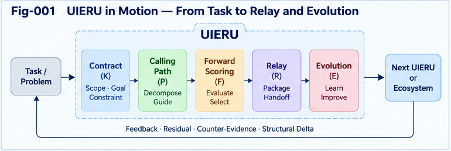
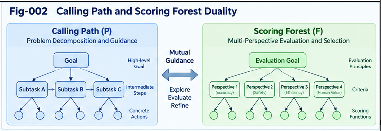

# UIERU-002 — Canonical UIERU: Contracts, Execution, Guidance, and Relay

**Universal Intelligence Evolution and Relay Unit (UIERU)**  
**Subtitle:** A Minimal Operational Contract for Composable, Forward-Guided, Relayable, and Evolvable Intelligence  
**Authors:** Sizhe Tan & GPT-Obot  
**Version:** 1.0.0  
**Date:** 2026-10-20  
**Status:** Proposed architecture and normative-design candidate; not a ratified interoperability standard  
**Repository:** [Universal-Intelligence-Evolution-and-Relay-Unit](https://github.com/sizhet/Universal-Intelligence-Evolution-and-Relay-Unit)  
**Companion:** [UIERU-001 — From Calling Paths to Evolvable Intelligence Units](UIERU-001-From-Calling-Paths-to-Evolvable-Intelligence-Units.md)

---

## Abstract

Intelligent tasks are frequently distributed among humans, models, agents, services, and organizations. Execution paths may be documented without preserving the criteria that guided them; evaluations may arrive only after an action has finished; and handoffs may omit authority, evidence, unresolved risks, or reusable alternatives. This paper specifies a **canonical architectural model** for the Universal Intelligence Evolution and Relay Unit (UIERU), a selectively adopted organizational boundary for linking these functions without replacing their implementations.

The proposed unit is represented as **U = (K, P, F, R, E)**: a governing contract, an executable or observable calling path, a forward-guiding scoring forest, a relay interface, and a structural evolution mechanism. We define minimal and extended profiles; identify the identities, state transitions, invariants, and obligations of each component; outline a portable relay envelope; and show how a unit may compose with other units while preserving recipient evaluation sovereignty. Multi-trail sandboxing is specified as an optional but important advanced capability. The result is a concrete basis for subsequent lifecycle, relay, and conformance specifications, not an empirical claim of universal benefit.

**Keywords:** UIERU; canonical unit; task contract; calling path; scoring forest; forward guidance; relay envelope; provenance; multi-trail; composition; structural evolution; conformance.

## 1. Start with a Task, Not a New Kind of Agent

Consider a neighborhood lawn-care service. The customer specifies an area, a deadline, acceptable quality, a budget, and safety constraints. The provider chooses a route through preparation, mowing, cleanup, inspection, and completion. Weather may change the plan. The customer must be able to inspect the result. The next provider may benefit from a record of the equipment used, difficulties encountered, and remaining work.

A simple workflow can express:

```text
Request -> Prepare -> Mow -> Clean -> Inspect -> Complete
```

A **UIERU** adds an explicit, transferable organizational boundary around this work:

```text
Contract (who, what, constraints, authority)
          |
          v
Forward Guidance <----> Calling Path / Execution
          |                    |
          +---- Evidence ------+
                    |
                    v
          Evaluation & Settlement
                    |
                    v
          Relay + Candidate Improvements
```

Nothing here requires a new model, an autonomous agent, or an elaborate runtime. The worker may be human; scoring may be a checklist; the relay may be a signed work record. The architecture becomes useful when these elements need to remain coherent across execution, handoff, and improvement.

**Design principle:** UIERU is a *selective organizational container*, not a compulsory replacement for functions, workflows, agents, or human judgment.

---



---

## 2. Canonical Definition

We propose the five-part architectural representation:

$$
U=(K,P,F,R,E)
$$

| Component | Canonical name | Engineering responsibility |
|---|---|---|
| **K** | Contract | Defines task scope, subjects, object/state, goals, permissions, constraints, acceptance, and obligations |
| **P** | Calling Path | Represents executable or observable actions, dependencies, transitions, checkpoints, and evidence |
| **F** | Scoring Forest | Guides decisions *before* execution, monitors choices *during* execution, and evaluates outcomes *after* execution |
| **R** | Relay | Packages deliverables, state, evidence, provenance, open obligations, and recipient acceptance requirements |
| **E** | Evolution | Records residuals and candidate structural deltas, with validation and version governance |

This representation is a **design decomposition**, not a theorem that every intelligence process naturally consists of exactly five parts. The elements may be distributed among existing systems. Their interfaces and responsibilities, rather than physical colocation, define the unit.

### 2.1 The underlying subject–action–object semantics

Any practical contract answers three ordinary questions: **who acts, what happens, and what is acted upon?** These semantics are contained in `K` and `P`. A reader does **not** need prior knowledge of Subject–Predicate–Object Structural Intelligence (SPO-SI). SPO-SI is a related conceptual perspective, not a prerequisite or required dependency.

### 2.2 Unit identity and version

A unit instance should distinguish:

- `unit_id`: stable identity of the organizational unit or capability;
- `instance_id`: identity of a particular invocation or execution;
- `contract_version`: version of obligations and acceptance rules;
- `structure_version`: version of path, scoring, relay, and evolution configuration;
- `parent_unit_id` and `child_unit_ids` where applicable;
- `provenance`: origins of artifacts, evaluations, and revisions.

Identifiers must not be mistaken for trust guarantees: authenticity, access control, and integrity require appropriate implementation mechanisms.

## 3. K — Contract: The Governance Boundary

A contract is more than a natural-language request. It defines the conditions under which a unit may act and a recipient may accept its outputs.

### 3.1 Recommended contract fields

| Field | Purpose |
|---|---|
| Task and objective | Desired outcome and definition of success |
| Initiating subject | Who requests or authorizes work |
| Responsible executor(s) | Who or what may carry out the work |
| Object and initial state | Target resource, system, or environment |
| Permissions and prohibitions | Allowed actions, hard constraints, safety boundaries |
| Resources and limits | Time, cost, compute, materials, tool access |
| Acceptance criteria | How completion and quality are determined |
| Evaluation perspectives | Whose criteria matter and who may challenge them |
| Handoff requirements | Deliverables, recipient, evidence, unresolved obligations |
| Escalation and termination | Stop conditions, failures, human review, cancellation |
| Version and provenance | Which contract governs which run |

**Hard constraints precede soft optimization.** A high task score cannot authorize a prohibited action. Where multiple parties participate, the contract must make decision and veto authority explicit rather than silently averaging their interests.

### 3.2 Contract compatibility

A prospective executor or recipient must be able to determine whether its authority, capabilities, constraints, and acceptance criteria are compatible with the contract. A successful data transfer is not necessarily a valid contractual handoff.

## 4. P — Calling Path: The Dynamic Execution Structure

A Calling Path is a sequence or subgraph of action and state-transition events. It may include branches, retries, parallel threads, nested calls, external tools, human decisions, and deferred steps. A **Calling Graph** represents the wider dependency and invocation structure; a unit may own one bounded path or a bounded subgraph.

Each significant step should, when practical, expose:

```text
step_id | input_state | action_or_call | responsible_actor
        | preconditions | expected_effect | observed_effect
        | evidence_refs | status | timestamp_or_order
```

The path may be a *plan*, an *observed trace*, or both. They must not be confused: planned actions are hypotheses about execution, whereas observed actions require evidence. Preserve discrepancies as first-class information.

### 4.1 Checkpoints and trace folding

Long paths need not be transmitted as raw event logs. They may be summarized into checkpoints or folded subpaths **provided that** relevant dependencies, safety events, uncertainty, and provenance remain recoverable or explicitly marked as omitted. A compact trace without its omitted-risk annotation can be dangerously misleading.

## 5. F — Scoring Forest: Guidance Before, During, and After

The Scoring Forest is not merely an end-of-task grading function. It is the unit's **directional control and evaluation structure**.

---



---

### 5.1 Three operational phases

**Before execution — forward guidance:** generate or compare candidate paths; consider constraints, feasibility, expected outcomes, uncertainty, and exploration value; allocate resources or request additional evidence.

**During execution — online guidance:** compare observations against expectations; detect constraint violations and drift; re-score remaining paths; pause, escalate, or replan when appropriate.

**After execution — evaluation and settlement:** assess delivered results against contract criteria; preserve supporting evidence and dissenting perspectives; determine acceptance, rejection, remediation, or conditional continuation.

### 5.2 Forest rather than a single scalar

Different objectives can require separate trees or evaluators: quality, cost, timeliness, risk, reliability, recipient preference, and information gain. The forest may contain hard gates, rankings, conditional policies, uncertainty ranges, and non-comparable perspectives. A single scalar score is **not** mandatory.

For illustrative feasible paths `p`:

$$
\mathcal P_{\mathrm{feasible}}=\{p\in\mathcal P:operatorname{HardConstraints}(p,K)=\mathrm{true}\}
$$

$$
 p^*\in operatorname{Select}_{F}(\mathcal P_{\mathrm{feasible}},K,\mathcal E)
$$

Here `Select_F` may implement ranking, Pareto filtering, human approval, or a policy-controlled search; `\mathcal E` denotes available evidence. This avoids implying that every situation admits a valid globally optimal scalar score.

### 5.3 Scoring folding and conflicts

When child units compose, their scores cannot generally be summed. A parent may have shared resources, cross-unit dependencies, and distinct stakeholders. Folding therefore requires explicit aggregation rules, veto conditions, uncertainty preservation, and reconciliation of competing evaluation perspectives. This is a research challenge, not an automatically solved property of the unit definition.

## 6. R — Relay: Deliverables Plus the Conditions for Continuation

Relay is the transfer of **actionable continuity**, not merely a final answer. A minimal relay envelope should distinguish verified observations from estimates, identify open obligations, and specify what the recipient may safely do next.

### 6.1 Canonical relay envelope

```yaml
relay_id: relay-example-001
source_unit: lawn-service-unit
source_instance: run-001
contract_version: "1.0"
structure_version: "1.0"
recipient_role: next-service-provider
status: completed-with-observations
deliverables:
  - lawn-service-completion-record
evidence_refs:
  - inspection-record-001
state_summary:
  lawn: mowed-and-cleaned
open_obligations:
  - inspect-drainage-after-heavy-rain
uncertainties:
  - wet-area-recurrence-not-established
alternatives:
  - trail-b-low-impact-equipment
counter_evidence:
  - trail-c-slipped-on-wet-slope
candidate_deltas:
  - add-moisture-check-before-mowing
recipient_acceptance:
  required: true
  validation: check-contract-and-local-conditions
```

This is an **illustrative design sketch**, not a ratified YAML schema or a claim that these events occurred. A production schema must define types, required fields, signatures or integrity checks where needed, access policies, and version negotiation.

### 6.2 Relay Portfolio

A richer handoff may include the selected path **and** a bounded portfolio of alternative trails, rejected options, negative results, counter-evidence, residuals, and structural deltas. These should carry confidence and applicability conditions; the recipient need not adopt the sender's scoring preferences.

**Relay does not transfer evaluation sovereignty.** The receiving subject may accept, reject, re-evaluate, localize, or request additional evidence, within its own authority and contract.

## 7. E — Evolution: Candidate Changes, Not Automatic Self-Modification

Evolution is the ability to propose and test structural improvements, not an obligation to mutate after every run.

A candidate **structural delta** may change:

- path ordering, branch conditions, or tool selection;
- scoring criteria or calibration;
- sandbox exploration policy;
- relay fields or provenance requirements;
- contract templates, subject to renewed authorization;
- composition boundaries and reusable subunits.

Recommended progression:

```text
Residual / Opportunity
        -> Candidate Delta
        -> Sandbox or Controlled Test
        -> Counter-Evidence Review
        -> Authorized Acceptance or Rejection
        -> Versioned Release / Rollback Option
```

Preserve the distinction between **proposed**, **tested**, **accepted**, and **deployed** changes. Successful execution alone does not establish that a structural modification is generally safe or transferable.

## 8. Profiles: Lightweight First, Rich When Justified

A canonical architecture need not imply heavyweight mandatory infrastructure.

| Profile | Typical use | Expected capability |
|---|---|---|
| **Minimal UIERU** | Small bounded task | Contract, identifiable path, forward decision criteria, basic evidence-based handoff, improvement record or explicit no-change outcome |
| **Operational UIERU** | Multi-step service | Checkpoints, online re-scoring, acceptance and escalation, structured relay |
| **Exploratory UIERU** | Uncertain or complex tasks | Multi-trail candidate search, sandbox controls, counter-evidence, portfolio relay |
| **Collective UIERU** | Multi-party learning ecosystem | Provenance-aware exchange, local re-evaluation, composition, registry and version governance |

These are **proposed capability profiles**, not certified conformance levels. An activity that lacks forward guidance or any meaningful relay boundary may simply be a workflow or function; that is not a defect. Selective adoption prevents structural overhead from exceeding its benefits.

## 9. Canonical Lifecycle and State Machine

A proposed operational lifecycle is:

```text
DRAFT -> CONTRACTED -> PLANNED -> ACTIVE
                           |          |
                           |          +-> PAUSED / REPLANNING
                           |          +-> FAILED / CANCELLED
                           v          v
                       READY       EVALUATING
                                       |
                               ACCEPTED / REMEDIATION
                                       |
                                    RELAYED
                                       |
                                  ARCHIVED

Evolution candidates may branch from PLANNED, ACTIVE, EVALUATING,
or ARCHIVED into a separate governed TEST -> REVIEW -> VERSION process.
```

Transitions must be validated against the contract and actor authority. A failed or cancelled run may still relay useful evidence, but must not be marked successful. A unit can complete without creating a new version. A receiving unit may reject a handoff even after the sender reports completion.

### 9.1 Canonical lifecycle operations (conceptual)

| Operation | Preconditions | Output |
|---|---|---|
| `contract()` | Authorized requester, coherent scope | Contract version |
| `plan()` | Valid contract | Candidate calling paths and guidance record |
| `execute()` | Permitted action and valid preconditions | State transition and trace evidence |
| `evaluate()` | Evidence and criteria available | Assessment with uncertainty and dissent |
| `relay()` | Disclosure permissions, recipient conditions | Relay envelope / portfolio |
| `propose_delta()` | Residual or opportunity | Versioned candidate |
| `validate_delta()` | Sandbox/test and reviewer authority | Accept, reject, defer, or escalate |

These are *logical interfaces*; they do not prescribe a specific programming language, transport protocol, or agent framework.

## 10. Multi-Trail Sandboxes: An Advanced Guidance Profile

An advanced Scoring Forest can decide not only **which path to select**, but **whether to generate and test additional paths**. Multi-trail exploration may include:

1. **Exploit trail:** reuse a reliable known path;
2. **Explore trail:** test a new strategy or tool;
3. **Challenge trail:** seek counterexamples, boundary failures, or hidden costs.

Trails may be sequential, concurrent, simulated, or partly live. They require explicit budgets, isolation appropriate to the domain, stop rules, and safety gates. **Sandbox simulation is not equivalent to authorization for live execution.**

A useful portfolio includes paths that did not win. Rejected approaches may expose failure conditions or become useful under another recipient's objectives. Conversely, retaining every trace is costly and can violate privacy or confidentiality; relay policies must select, redact, summarize, or withhold material appropriately.

## 11. Composition and Nested Units

A larger unit may coordinate child units:

$$
U_{\mathrm{parent}}=operatorname{Compose}(U_1,\ldots,U_n;K_{\mathrm{parent}})
$$

Valid composition requires more than matching input/output types:

- compatible contracts and delegated authority;
- ordering, state, resource, and timing consistency;
- clear accountability and escalation paths;
- explicit treatment of conflicting scoring perspectives;
- preservation of material evidence and unresolved obligations;
- failure containment and appropriate rollback or compensation.

A locally conformant child can still contribute to a globally invalid system. **Composition closure is a hypothesis to characterize, not an axiom.**

## 12. Minimal Worked Example: Lawn-Care UIERU

**Contract:** mow a specified lawn by Friday, stay within the agreed price, protect people and property, and obtain customer acceptance.

**Calling Path:** inspect weather and terrain; prepare equipment; mow; clean; inspect; present results.

**Forward Scoring:** before starting, compare a standard mowing path with postponement if the ground is too wet; during work, stop if traction or visibility becomes unsafe; afterward, assess completeness and quality.

**Relay:** deliver completion status, inspection evidence, relevant site conditions, and any unresolved drainage issue to the customer or next provider.

**Evolution:** propose a moisture-check step for future runs; test whether it reduces rework and safety incidents before promoting it into the standard path.

This example shows why **K/P/F/R/E** is sufficient as a first reading model. It also shows that the Scoring Forest can be a small policy tree rather than a large AI model.

## 13. Conformance Candidates and Failure Tests

A future conformance suite should test observable properties rather than merely checking whether a file contains all five labels.

| Property | Example test | Failure signal |
|---|---|---|
| Contract authority | Attempt an action outside delegated permission | Unauthorized action executes |
| Forward guidance | Change a hard precondition before execution | Path remains unsafe or unadjusted |
| Evidence fidelity | Compare trace summary to source events | Material omission not disclosed |
| Recipient sovereignty | Recipient rejects incompatible scoring | Sender score overrides recipient policy |
| Relay continuity | Resume from envelope with an independent executor | Missing state or unresolved obligation |
| Sandbox separation | Trial path requests a prohibited live side effect | Live side effect escapes isolation |
| Version governance | Reject an unvalidated candidate delta | Candidate silently becomes production |
| Composition | Combine locally valid but globally conflicting units | Conflict goes undetected |

These tests are proposed design targets; no measured results are claimed here.

## 14. Research Questions and Limits

1. **Minimum useful structure:** When does the coordination and relay benefit exceed contract, trace, and scoring overhead?
2. **Forward-guidance quality:** Which search and scoring methods improve outcomes under bounded time and compute?
3. **Multi-trail value:** When does additional exploration outperform a single strong path after accounting for cost and risk?
4. **Relay fidelity:** Which evidence and uncertainty fields are essential for reliable continuation?
5. **Compositional validity:** Under what conditions can nested units preserve governance and scoring semantics?
6. **Collective learning:** How can candidate structures travel across subjects without transferring inappropriate authority or preferences?
7. **Privacy and security:** What must be minimized, redacted, signed, or withheld during relay?

A UIERU is not presumed superior to ordinary workflows, service APIs, agent orchestration, or domain-specific control systems. Comparative experiments and negative cases are necessary to establish its useful scope.

## 15. Interfaces to the Rest of the Research Series

This paper supplies the **canonical vocabulary and boundaries**. Later papers specialize the mechanisms:

- **UIERU-003:** Calling Path and Scoring Forest duality;
- **UIERU-004:** forward guidance and multi-trail intelligence;
- **UIERU-005:** sandbox threading and counter-evidence;
- **UIERU-006:** composition, nesting, folding, and contract reconciliation;
- **UIERU-007:** structural relay, provenance, and portability;
- **UIERU-008:** bidirectional collective learning;
- **UIERU-009:** residual-driven structural evolution;
- **UIERU-010:** engineering boundaries and validation.

Engineering contracts and lifecycle details are reserved for `specs/SPEC-001` through `SPEC-004`. These documents should refine, not silently contradict, the definitions introduced here.

## 16. Conclusion

The canonical UIERU is a practical architectural proposal: **a governed contract, a calling path, a forward-guiding scoring forest, a relay boundary, and a controlled evolution mechanism**. The unit is defined by how these responsibilities cooperate, not by any particular model or software stack. It can be lightweight, nested, exploratory, or collective, and it can coexist with tasks that do not benefit from structural containerization.

The strongest engineering promise is not merely better recordkeeping. It is the ability to **guide work before it happens, preserve what was learned while it happens, and relay actionable evidence and candidate improvements afterward**—without confusing transfer with authority, exploration with deployment, or an architectural hypothesis with an experimentally established result.

---

## Suggested Citation

Tan, Sizhe, and GPT-Obot. (2026). *UIERU-002 — Canonical UIERU: Contracts, Execution, Guidance, and Relay*. Universal Intelligence Evolution and Relay Unit, version 1.0.0. GitHub repository: https://github.com/sizhet/Universal-Intelligence-Evolution-and-Relay-Unit

## License and Reuse

Refer to the repository's published license and citation metadata for applicable terms. This document proposes an open research architecture; no interoperability certification or empirical performance guarantee is implied.
