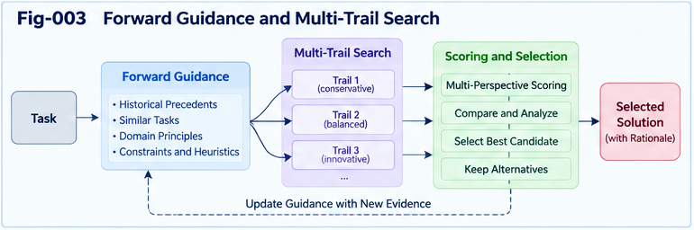

# UIERU-004 — Forward Guidance and Multi-Trail Intelligence

**Universal Intelligence Evolution and Relay Unit (UIERU)**  
**Subtitle:** From Path Scoring to Governed Exploration, Threading Tracks, and Evolutionary Relay  
**Authors:** Sizhe Tan & GPT-Obot  
**Version:** 1.0.0  
**Date:** 2026-10-20  
**Status:** Research architecture and testable algorithmic proposals

---

## Abstract

A Calling Path records or organizes a sequence of actions, dependencies, and state transitions. A scoring system can assess that path after execution. Neither property, by itself, makes the path an actively guided, explorative intelligence unit. This paper develops **Forward Guidance and Multi-Trail Intelligence** within the Universal Intelligence Evolution and Relay Unit (UIERU) architecture. The central proposal is that a Scoring Forest should guide action *before* execution, monitor and revise decisions *during* execution, and evaluate outcomes *after* execution. Under uncertainty, it may allocate bounded resources to multiple candidate trails: established approaches, exploratory alternatives, and adversarial or counter-evidence-seeking tracks. Their outputs can be compared, folded where justified, and transferred as an evidence-bearing **Relay Portfolio** rather than reduced to a single winning answer.

We specify a conceptual lifecycle, candidate-scoring model, trail-state machine, budgeted scheduling procedure, feedback contracts, and safeguards against score gaming, unsafe experimentation, and premature folding. We distinguish real execution from simulation and offline testing, and distinguish executable threads from conceptual alternatives. The framework is intended to organize existing human and machine capabilities, not replace them. Its benefits are hypotheses requiring comparison against simpler single-path workflows and existing planning systems.

**Keywords:** UIERU; forward guidance; Calling Path; Scoring Forest; multi-trail intelligence; threading tracks; sandbox; counter-evidence; budgeted search; relay portfolio; structural evolution; collective learning.

---

## 1. The Engineering Problem: A Path Is Not Yet Guidance

Consider a service request: restore a malfunctioning application within a fixed maintenance window. A conventional workflow might specify diagnosis, patch, test, deploy, and report. A Calling Graph adds dependencies, alternative branches, and execution history. Yet a useful intelligent controller must also answer:

- Which diagnostic path should be attempted first, and why?
- When is it worth exploring a competing explanation?
- Which tests can run safely in isolation, and which require authorization?
- When should a branch be stopped, resumed, or promoted?
- What should be handed to the next operator besides the selected fix?

A post-hoc score answers too late. **Forward Guidance** is the process of using goals, constraints, evidence, and a structured valuation system to influence candidate generation, branch selection, resource allocation, and action sequencing before consequential steps are taken.

**Multi-Trail Intelligence** extends this principle: instead of always committing to one path, a governed controller may maintain a portfolio of alternative trajectories, with explicit costs, safety boundaries, and learning purposes.

The thesis is not that multiple trails always outperform one trail. It is that **the decision to branch, compare, and relay alternatives should itself be subject to intelligent guidance**.

## 2. A Self-Contained UIERU Model

For engineering purposes, represent a UIERU as:

$$
U=(K,P,F,R,E)
$$

where:

- **K — Contract:** task, stakeholders, goals, scope, authorization, resource limits, and non-negotiable constraints.
- **P — Calling Path:** executable or describable action paths and their dependencies, observations, and state changes.
- **F — Scoring Forest:** multiple perspectives and scoring operators used for planning, online control, comparison, and settlement.
- **R — Relay:** versioned transfer of outputs, evidence, unresolved questions, responsibilities, and reusable alternatives.
- **E — Evolution:** controlled creation, validation, adoption, rejection, and rollback of structural changes.

This is a **selective organizational abstraction**, not a claim that every computation needs five heavyweight subsystems. A minimal task may use a simple path and a few constraints; a high-stakes task may require extensive sandboxing, independent evaluators, and human authorization.

A **trail** is a candidate or realized trajectory through some portion of the Calling Graph. A **threading track** is a managed line of investigation or execution associated with one or more trails. A **sandbox** is an isolation or simulation environment used to test a track without assuming that its effects are equivalent to the real world. These terms are related but not interchangeable.

## 3. Forward Guidance Across Three Time Horizons

### 3.1 Before execution: prospective guidance

Before action, the Scoring Forest should help:

1. interpret the contract and hard constraints;
2. generate or request candidate paths;
3. estimate value, feasibility, risk, uncertainty, and learning potential;
4. decide whether to execute one path or open multiple tracks;
5. allocate time, compute, tools, and evaluation effort;
6. establish observable checkpoints and stop conditions.

This is **guidance**, not a guarantee of globally optimal planning.

### 3.2 During execution: adaptive guidance

As observations arrive, the controller can update beliefs, revise scores, reallocate resources, pause unsafe tracks, and create a new branch if a significant residual emerges. State changes should be recorded so that subsequent evaluation can distinguish what was planned from what actually occurred.

### 3.3 After execution: settlement and learning

Afterward, the system reconciles predictions with observations, identifies violated assumptions, records accepted and rejected trails, and produces a Relay Portfolio. This phase is essential, but **it does not replace prospective guidance**.

## 4. Calling Path–Scoring Forest Coupling

Let $\mathcal{P}_t$ denote the available candidate trails at time $t$, $x_t$ the observed task state, and $K$ the governing contract. A conceptual controller performs:

$$
(\mathcal{P}_{t+1}, a_t, b_t)
=\pi_F(\mathcal{P}_t,x_t,K,H_t)
$$

Here $a_t$ is the next permitted action or branch decision, $b_t$ is the exploration budget allocation, and $H_t$ is accumulated evidence. The policy $\pi_F$ is not necessarily a learned neural policy: it may be a rule system, optimizer, human-led process, LLM-assisted planner, or hybrid.

The coupling has two directions:

**Forest → Path:** constraints, candidate priorities, resource allocations, safety gates, and guidance decisions.

**Path → Forest:** observed outcomes, uncertainty changes, failures, cost records, counter-evidence, and new structural candidates.

This duality is operational only when feedback can influence subsequent decisions. A disconnected score report is not sufficient.

## 5. Why a Forest Rather Than One Scalar Score?

Real tasks combine multiple, potentially incompatible perspectives: task quality, speed, cost, safety, user preference, organizational policy, and information gain. A Scoring Forest preserves distinct scoring trees or operators so that disagreements remain inspectable.

For candidate trail $p$, define a descriptive score vector:

$$
\mathbf{s}(p)=[q(p),c(p),r(p),i(p),u(p),g(p)]
$$

where $q$ is task quality, $c$ cost, $r$ risk, $i$ expected information gain, $u$ uncertainty, and $g$ governance or contractual fit. These quantities may be estimates with intervals, not precise facts.

A provisional utility for **feasible** trails might be:

$$
J(p)=\mathbb{E}[q(p)]+\lambda i(p)-\mu c(p)-\nu r(p)
$$

subject to:

$$
p\in\mathcal{P}_{\mathrm{authorized}},\qquad
operatorname{HardConstraints}(p,K)=\mathrm{true}.
$$

The utility is a decision aid, **not** permission to trade away hard safety, legal, privacy, or authorization constraints. When perspectives are incommensurable, the system should retain a Pareto set, use lexicographic priorities, or escalate to an authorized decision-maker rather than invent a misleading scalar total.

## 6. Multi-Trail Intelligence: Exploit, Explore, Challenge

A useful initial taxonomy separates three track roles.

### 6.1 Exploit track

Use a known or well-tested path with comparatively predictable performance. This often supplies the operational baseline and fallback.

### 6.2 Explore track

Investigate a plausible alternative tool, plan, decomposition, or strategy. The goal may be improved task performance, structural reuse, or reduction of important uncertainty.

### 6.3 Challenge track

Actively seek counterexamples, boundary failures, hidden dependencies, or reasons the favored path may be wrong. The challenge track need not propose a replacement: its value may be a trustworthy falsification.

The roles can overlap. A trail may begin as exploration and later become the baseline. Some tasks warrant no parallel branches; others warrant several. **Multi-trail is a capability and policy choice, not a mandatory execution pattern.**

---



*Fig. 003. Forward Scoring Forest guides the generation, screening, resource allocation, evaluation, and selective folding of exploit, explore, and challenge trails; evidence and residuals flow into a Relay Portfolio.*

---

## 7. Threading Tracks and Sandbox Boundaries

A threading track has a purpose, owner, environment, inputs, constraints, evaluator, evidence log, budget, and lifecycle state. Parallelism can be logical rather than physical: the controller may evaluate candidates sequentially or in batches.

Three execution environments should be distinguished:

| Environment | Appropriate use | Principal limitation |
|---|---|---|
| Offline analysis | Compare designs and hypotheses | Estimates may not match execution |
| Isolated sandbox | Run tests, simulations, and adversarial probes | Isolation and fidelity must be checked |
| Authorized live execution | Act on the actual task environment | Real-world consequences and governance obligations |

Promotion from sandbox to live action requires a separate authorization gate. Passing a simulation is evidence, not proof of real-world safety or effectiveness.

## 8. The Trail Lifecycle

A proposed state machine is:

`PROPOSED → SCREENED → ALLOCATED → RUNNING → EVALUATED → {ACCEPTED | REJECTED | INCONCLUSIVE}`

Additional transitions:

- `RUNNING → PAUSED` when budgets, dependencies, or risk conditions change;
- `RUNNING → ABORTED` when hard constraints or stop rules are violated;
- `EVALUATED → REVISED → SCREENED` for a modified candidate;
- `ACCEPTED → RELAYED` when evidence and contract obligations are packaged;
- `REJECTED/INCONCLUSIVE → RELAYED` when negative or unresolved findings are worth preserving.

Every transition should be attributable to a decision rule or accountable actor. An `ACCEPTED` trail is accepted **for a specified context and purpose**, not universally certified.

## 9. A Budgeted Multi-Trail Guidance Algorithm

The following pseudocode is a reference architecture, not production-ready code.

```text
INPUT: contract K, initial state x, candidate generators G,
       scoring forest F, budget B, policy gates Q

1. Verify contract scope, permissions, and hard constraints.
2. Generate baseline candidate(s) using G.
3. Score feasibility, risk, expected task value, and uncertainty.
4. If branching benefit is insufficient, select a single path.
5. Otherwise, create bounded EXPLOIT / EXPLORE / CHALLENGE tracks.
6. For each scheduling round while budget and authority remain:
     a. Reassess constraints and track-level stop conditions.
     b. Allocate resources to admissible tracks.
     c. Execute permitted offline/sandbox/live steps.
     d. Record observations, provenance, cost, and counter-evidence.
     e. Update scoring estimates and confidence ranges.
     f. Pause, terminate, extend, or spawn tracks as justified.
7. Compare outcomes; preserve incompatible perspectives.
8. Authorize any promotion to consequential execution.
9. Produce a Relay Portfolio with selected and nonselected trails.
10. Propose structural deltas for separate validation and adoption.
OUTPUT: authorized outcome, evidence, relay portfolio, delta proposals
```

This procedure separates **candidate generation**, **scoring**, **execution authorization**, and **structural adoption**. A high score alone cannot perform the last two functions.

## 10. When Should the Controller Branch?

Branching has opportunity cost. A practical decision criterion compares the expected incremental value of exploration with its total cost:

$$
\Delta V_{\mathrm{branch}}=
\mathbb{E}[V\mid\mathrm{branch}]
-\mathbb{E}[V\mid\mathrm{single}]
-C_{\mathrm{branch}}.
$$

The controller should consider branching when the estimated value is positive **and** all hard constraints permit it. Relevant factors include:

- uncertainty about the best path;
- asymmetric failure consequences;
- availability of low-cost sandbox experiments;
- diversity among candidates rather than superficial duplicates;
- potential reuse of the findings by future tasks or other UIERUs;
- available evaluation capacity and decision deadlines.

A branching controller should also recognize diminishing returns: ten nearly identical trails may provide less information than two genuinely distinct ones.

## 11. Online Replanning and Stop Rules

Forward Guidance continues during execution. New evidence may reveal a blocked dependency, unexpected expense, emerging hazard, or a stronger alternative.

Useful stop rules include:

1. **Safety stop:** hard constraints are threatened or violated.
2. **Budget stop:** authorized time, compute, or financial resources are exhausted.
3. **Dominance stop:** a trail is convincingly inferior under the relevant criteria.
4. **Information stop:** additional tests have low expected information value.
5. **Deadline stop:** remaining time requires a controlled commitment or handoff.
6. **Governance stop:** authorization is revoked or a human review is required.

Uncertainty should be represented honestly. Inconclusive results must not be silently converted into success or failure.

## 12. Evaluation, Comparison, and Structural Folding

After exploration, the system compares candidate trails across outcome quality, risk, cost, contract fit, robustness, and information gain. It should preserve evidence and dissenting evaluations.

**Folding** is a selective compression or composition operation. It may:

- replace several redundant paths with a validated reusable macro-path;
- preserve a conditional branch for contexts where different trails excel;
- extract a common subroutine without discarding crucial exceptions;
- combine complementary partial solutions after interface checks.

However, a score average or a compressed summary is not automatically a valid fold. In particular, differing stakeholder objectives, failure modes, and unresolved counter-evidence must remain visible where they affect decisions. A fold should specify the evidence it preserves, the detail it omits, and its conditions of validity.

## 13. Relay Portfolio: More Than the Winning Trail

A conventional handoff often transfers only a selected result. Multi-Trail Intelligence makes a richer handoff possible.

A **Relay Portfolio** can contain:

- the accepted path and its execution record;
- alternative paths and the contexts in which they may work;
- failed or rejected paths, with failure reasons;
- counter-evidence and evaluator disagreement;
- cost, timing, and uncertainty estimates;
- unresolved residuals and open questions;
- candidate structural deltas and validation status;
- permissions, provenance, ownership, and receiving-party obligations.

A minimal illustrative YAML envelope:

```yaml
uieru_relay:
  schema_version: "0.1-proposal"
  unit_id: "maintenance-example-01"
  contract_ref: "contract-01"
  source_subject: "authorized-service-team"
  recipient_subject: "next-service-team"
  selected_trail:
    id: "trail-a"
    status: "accepted-for-current-context"
    evidence_refs: ["test-report-a", "review-a"]
  alternative_trails:
    - id: "trail-b"
      status: "inconclusive"
      residuals: ["insufficient-load-test-coverage"]
    - id: "trail-c"
      status: "rejected"
      counter_evidence_refs: ["failure-case-c"]
  structural_delta_proposals:
    - id: "delta-01"
      status: "unvalidated"
  limitations:
    - "sandbox results are not production certification"
  receiver_review_required: true
```

This is an **illustrative proposed schema**, not an established interoperability standard. The recipient retains the right and responsibility to re-evaluate evidence against its own context and authority.

## 14. From Trail Residuals to Structural Evolution

A residual is a relevant difference between what the existing structure can explain or accomplish and what the task demands or evidence reveals. Examples include an unhandled edge case, a failed assumption, an evaluation conflict, or a new opportunity.

A proposed evolution pipeline is:

`Residual → Candidate Delta → Sandbox Comparison → Counter-Evidence → Validation → Authorized Adoption → Versioned Relay`

Possible deltas include a new Calling Path branch, a changed scoring operator, a revised contract, a specialized evaluator, or a new composition boundary. Adoption must be distinguishable from proposal: **a plausible improvement is not yet a verified improvement**.

Evolution can occur locally or through collective exchange. A UIERU may contribute a validated trail or a negative result to a registry, and another UIERU may localize and test it before reuse. This creates a bidirectional provider–consumer relationship rather than one-way distribution of answers.

## 15. Worked Example: A Software Maintenance Task

Suppose a team must repair a latency regression without violating a deployment window or data-protection rules.

**Contract:** restore latency below an agreed threshold; preserve correctness and privacy; restrict production changes to approved operators.

**Calling Path:** diagnose → propose fix → test → review → deploy → observe.

**Forward Scoring Forest:** compare expected latency improvement, regression risk, implementation cost, rollback ease, and strength of evidence. Security and authorization constraints remain hard gates.

**Track A — Exploit:** optimize a known database query pattern using a tested patch.

**Track B — Explore:** prototype an alternative caching strategy in an isolated environment.

**Track C — Challenge:** construct adversarial tests to expose stale-data or concurrency failures in the leading candidates.

The forest allocates more sandbox effort to Track B if its potential benefit justifies the cost, but retains Track A as a fallback. Track C may invalidate both candidates or reveal missing acceptance tests. After review, the authorized team deploys one path and packages the others with evidence and unresolved issues for future maintenance work.

The value of the UIERU is not simply parallel coding. It is the **joint governance of path selection, exploratory evidence, consequential execution, and reusable handoff**.

## 16. Design Principles and Non-Goals

### Design principles

1. **Organize, do not replace:** existing LLMs, agents, planners, tools, databases, and human experts remain valid components.
2. **Selective adoption:** a simple task may not justify multi-trail overhead.
3. **Forward guidance first:** scoring must influence decisions before consequential action.
4. **Evidence-bearing trails:** preserve outcomes, provenance, and uncertainty.
5. **Counter-evidence by design:** challenge tracks may have positive value even without a winning solution.
6. **Separation of scoring and authority:** evaluation never substitutes for permission.
7. **Receiver sovereignty:** downstream users can re-score, reject, or localize a relay.
8. **Reversible evolution:** candidate deltas need validation, versioning, and rollback where feasible.

### Non-goals

UIERU does not claim to solve general intelligence, eliminate all workflow overhead, prove that multi-trail search is universally superior, or establish a single universal numeric scoring scale. It is not a mandatory container for every computation and does not require a new AI model architecture.

## 17. Failure Modes and Safeguards

| Failure mode | Consequence | Proposed safeguard |
|---|---|---|
| Score gaming / Goodhart effects | High reported score, poor real outcome | Independent checks and counter-evidence tracks |
| Duplicate trail proliferation | Wasted compute and evaluator capacity | Diversity checks, budgets, stop rules |
| Sandbox-to-live overgeneralization | Unsafe promotion | Explicit fidelity limits and authorization gates |
| Premature folding | Loss of exceptions or uncertainty | Evidence-preserving fold contracts |
| Untrusted relay data | Incorrect downstream decisions | Provenance, validation, receiver-side review |
| Hidden evaluator conflicts | Misleading single score | Perspective-preserving Scoring Forest |
| Endless exploration | Missed deadlines and delayed service | Time-bounded scheduling and fallback paths |
| Structural regression | New version performs worse | Conformance tests, canary evaluation, rollback |

These safeguards are research and engineering requirements, not claims of already achieved safety.

## 18. Testable Hypotheses and Experimental Plan

**H1 — Prospective guidance:** Under comparable budgets, forward-guided path selection improves task quality or constraint satisfaction over post-hoc-only scoring.

**H2 — Selective branching:** Budgeted multi-trail exploration improves outcome quality or robustness on sufficiently uncertain tasks relative to a single-path baseline; benefits diminish on simple tasks.

**H3 — Challenge value:** Dedicated counter-evidence tracks discover consequential failures that exploit-only execution misses.

**H4 — Relay richness:** Evidence-bearing Relay Portfolios improve downstream diagnosis, reuse, or handoff reliability compared with result-only transfer.

**H5 — Structural growth:** Validated trail-derived deltas improve later task performance without unacceptable regression rates.

Suggested comparison arms:

- **B0:** ordinary sequential workflow without structured forward scoring;
- **B1:** single-path workflow with forward scoring;
- **B2:** multi-trail workflow without explicit evidence-preserving relay;
- **B3:** full proposed multi-trail UIERU with relay and delta governance.

Measure task success, quality, risk events, latency, token/compute expenditure, human review time, counterexample discovery, transfer fidelity, reuse rate, and regression frequency. Randomize comparable tasks where practical; stratify by complexity and uncertainty. Report overhead and negative findings, not just successful cases.

Ablation studies should isolate the effects of forward scoring, challenge tracks, portfolio relay, and structural delta validation. None of these hypotheses should be treated as confirmed without empirical evidence.

## 19. Relationship to the UIERU Research Series

This paper is self-contained but fits within a broader sequence:

- **UIERU-001:** why governed paths can become evolvable intelligence units;
- **UIERU-002:** canonical contracts, execution, guidance, relay, and evolution;
- **UIERU-003:** Calling Path–Scoring Forest duality;
- **UIERU-004 (this paper):** prospective guidance and managed multi-trail search;
- **UIERU-005:** sandbox threading, counter-evidence, and adversarial validation;
- **UIERU-006:** composition, nesting, folding, and contract reconciliation;
- **UIERU-007:** structural relay, provenance, and portability;
- **UIERU-008:** bidirectional collective learning;
- **UIERU-009:** residual-driven evolution and recursive improvement;
- **UIERU-010:** architecture, engineering boundaries, and validation.

No prior knowledge of the Subject–Predicate–Object Structural Intelligence (SPO-SI) project is required. Related structural-intelligence work provides optional historical and conceptual context, not a prerequisite.

## 20. Open Research Questions

1. How can the expected information gain of a trail be estimated when evaluator quality is itself uncertain?
2. When should scoring perspectives be aggregated, kept separate, or escalated to human arbitration?
3. How can exploration budgets be allocated without systematically favoring easily measurable but low-value tracks?
4. Which parts of sandbox evidence transfer reliably across environments and organizations?
5. What minimum provenance is necessary for safe and useful Relay Portfolio exchange?
6. Can a system learn reusable branch-and-stop policies without creating self-reinforcing evaluation biases?
7. How should collective registries rank contradictory experiences from distinct subjects and contexts?
8. Which classes of tasks benefit enough from multi-trail guidance to justify its structural overhead?

## 21. Conclusion

The decisive shift from an ordinary Calling Path to an evolvable intelligence unit is not merely attaching a score after execution. It is **coupling a governed action structure to prospective, adaptive, and evidence-aware guidance**. Multi-Trail Intelligence expands this coupling from choosing among paths to managing the *search for better paths*: exploiting established methods, exploring alternatives, and challenging assumptions within bounded and authorized environments.

The resulting unit can deliver more than a completed task. It can deliver a **Relay Portfolio** of selected paths, alternatives, counter-evidence, residuals, and candidate structural improvements. When receiving units evaluate and localize these artifacts, the same organizational mechanism can support bidirectional collective learning and open-ended structural evolution.

These benefits remain testable propositions, not established universal laws. The practical goal is a selective, composable, and governable way to help existing intelligence capabilities **act, explore, relay, and improve together**.

---

## Research Position and Attribution

This document presents a proposed research architecture and algorithmic design. Its terminology and organization are part of the UIERU research program by **Sizhe Tan & GPT-Obot**. Established adjacent areas include planning under uncertainty, multi-armed bandits, best-arm identification, hierarchical task planning, workflow orchestration, multi-agent systems, model-based testing, and continual learning. Claims of novelty or superiority require careful comparison with those literatures and empirical evaluation; the present document does not assert priority over them.

**Project:** Universal Intelligence Evolution and Relay Unit  
**Release:** v1.0.0  
**Document:** UIERU-004
