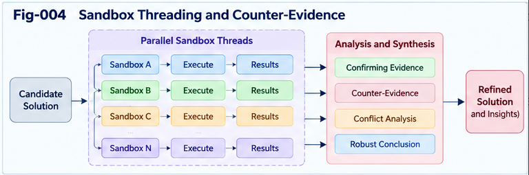

# UIERU-005 — Sandbox Threading and Counter-Evidence

## From Multi-Trail Exploration to Governed Structural Discovery

**Authors:** Sizhe Tan & GPT-Obot  
**Project:** Universal Intelligence Evolution and Relay Unit (UIERU)  
**Version:** 1.0.0  
**Status:** Conceptual research framework and proposed engineering specification  
**Date:** 2026-10-20

---

## Abstract

An intelligence system that chooses only among familiar execution paths may complete today's task while failing to discover tomorrow's better structure. The Universal Intelligence Evolution and Relay Unit (UIERU) addresses this limitation by combining a governed Calling Path with a forward-guiding Scoring Forest, structured relay, and validated evolution. This paper develops **Sandbox Threading and Counter-Evidence** as the exploratory mechanism of that architecture. Multiple candidate trails can be generated, isolated, evaluated, challenged, terminated, and selectively promoted. Their outcomes—including failed experiments and unresolved residuals—are retained in a provenance-aware Relay Portfolio rather than discarded after a winning path is selected. We specify thread lifecycle states, evidence standards, governance boundaries, a budget-aware scheduler, adversarial evaluation, structural-delta acceptance, and testable hypotheses. The framework is a research proposal, not a claim of demonstrated superiority: its value must be assessed against simpler single-path and conventional multi-agent baselines.

**Keywords:** UIERU; sandbox threading; multi-trail intelligence; counter-evidence; forward guidance; Calling Graph; Scoring Forest; structural relay; residual-driven evolution; collective learning.

---

## 1. The Engineering Problem

A workflow typically records or executes a chosen sequence. A planner may compare alternatives, and a test suite may check outputs. These capabilities are useful, but they are often separated across different tools, histories, and responsibility boundaries. As a result, the system may lose the reasoning behind a rejected path, the assumptions behind a passing test, or the context needed by another team to reproduce an experiment.

UIERU proposes an organizational unit that keeps **execution, guidance, evidence, relay, and structural improvement** connected. It does not replace language models, search algorithms, planners, simulation systems, humans, or existing orchestration frameworks. It provides a compatible envelope in which they can cooperate when the benefits exceed the coordination cost.

The present paper asks a narrower question: **How can a UIERU explore multiple trails safely, challenge its own preferred solutions, and turn the resulting evidence into reusable structural intelligence?**

## 2. Minimal UIERU Context

For self-contained reading, define a UIERU as

$$
U=(K,P,F,R,E),
$$

where:

- **K — Contract:** task, participants, authority, goals, resources, constraints, and acceptance conditions.
- **P — Calling Path:** executable or simulated action graph, including state transitions and observable events.
- **F — Scoring Forest:** perspective-aware forward guidance, online monitoring, comparative evaluation, and settlement.
- **R — Relay:** portable results, evidence, provenance, assumptions, outstanding issues, and handoff obligations.
- **E — Evolution:** candidate structural deltas, testing, acceptance, versioning, and rollback.

A **trail** is a candidate execution or investigation path under a particular set of assumptions. A **thread** is its managed experimental instance, with identity, isolation policy, resources, observations, and lifecycle state. Several threads may share a candidate trail but differ in seeds, tools, environments, or adversarial conditions. A **sandbox** is an environment with specified containment and authority boundaries; it need not be a virtual machine and is not automatically safe merely because it is called a sandbox.

## 3. Why Counter-Evidence Must Be First-Class

Ordinary optimization asks which candidate scores highest on available evidence. Robust structural intelligence must also ask:

1. Which observations would overturn the preferred candidate?
2. Which assumptions are untested or fragile?
3. Under what conditions does an apparently successful path fail?
4. Are we rewarding a proxy instead of the actual task outcome?
5. Which alternatives have not been fairly examined?

Counter-evidence is not simply a negative score. It is an **attributed, reproducible challenge to a claim, assumption, or expected behavior**. A failed test without sufficient context may be noise; a passing test without adversarial coverage may provide false confidence. Both must be represented with their limits.

This establishes an **anti-Goodhart** design principle: the Scoring Forest should expose metric gaming, specification gaps, and conflicts between locally attractive scores and governing objectives.

## 4. The Three Trail Families

### 4.1 Exploit trails

Use validated, familiar Calling Paths to meet the current contract efficiently. Their strengths include predictable cost and known operational characteristics; their weaknesses include inherited blind spots.

### 4.2 Explore trails

Test novel methods, tools, decompositions, compositions, or evaluation rules. These trails may yield improvements even if they do not win the current task.

### 4.3 Challenge trails

Attempt to falsify a favored trail's claims through edge cases, counterexamples, competing perspectives, perturbations, or adversarial tests. Their success criterion is **informative evidence**, not necessarily task completion.

These are roles rather than mutually exclusive implementation types. A single thread may transition between roles under explicit governance, and a UIERU may run only one role when appropriate.

## 5. Forward Guidance Governs the Search Itself

The Scoring Forest operates *before* threads launch, *during* their execution, and *after* evidence arrives.

**Before:** formulate candidate hypotheses; estimate value, uncertainty, risk, and resource needs; decide whether multi-trail exploration is justified; assign isolation and permissions.

**During:** observe progress; compare emerging evidence; pause, fork, redirect, or terminate threads; create challenge trails when contradictions appear.

**After:** evaluate claims against acceptance criteria; reconcile conflicts; record negative and positive results; construct the Relay Portfolio and candidate structural deltas.

Thus the scoring structure evaluates both **candidate paths** and the **search process that generates and tests them**. This is the transition from *Path Scoring* to *Search Process Scoring*.

## 6. A Budget-Aware Threading Objective

For a proposed thread \(i\), consider a research heuristic

$$
J_i = \mathbb{E}[V_i] + \lambda I_i + \eta D_i - \mu C_i - \nu R_i,
$$

where \(V_i\) is expected task contribution, \(I_i\) expected information gain, \(D_i\) expected diversity or counter-evidence value, \(C_i\) resource cost, and \(R_i\) estimated risk. The weights depend on the contract and perspective.

This heuristic is **not** a license to trade away hard safety requirements. A thread is eligible only if it satisfies independent constraints:

$$
operatorname{Eligible}(i) =
operatorname{Authorized}(i) \land
operatorname{WithinBudget}(i) \land
operatorname{WithinRiskLimits}(i).
$$

Where probability estimates are unreliable, the scheduler should use intervals, qualitative uncertainty, or conservative rules rather than fabricated precision. The system may also reserve resources for challenge trails even when their immediate expected task score is low.

## 7. Thread Lifecycle and State Machine

A proposed lifecycle is:

```text
PROPOSED
   |
   v
SCREENED --rejected--> ARCHIVED
   |
   v
AUTHORIZED
   |
   v
SANDBOXED --> RUNNING <--> PAUSED
                 |   \
                 |    +--> FORKED (new thread ID)
                 v
             OBSERVED
                 |
                 v
             EVALUATED
              /  |   \
             /   |    \
       REJECTED RETAINED PROMOTION-CANDIDATE
          |        |          |
          +--------+----------+
                   |
                   v
             RELAY-ARCHIVED
```

**Promotion-candidate** is deliberately distinct from production approval. Production deployment requires separate authorization, safety checks, and acceptance under the receiving contract. Threads may be terminated early, but termination reasons and partial evidence should remain available subject to retention and privacy policies.

---



---

## 8. Isolation, Authority, and Side-Effect Control

Sandbox threading can create operational hazards if experiments affect real systems. The contract should specify:

- **Execution mode:** analysis-only, simulation, test environment, or authorized production.
- **Side effects:** prohibited, reversible, approval-gated, or explicitly permitted.
- **Resources:** CPU, memory, tokens, time, API quotas, and human review budget.
- **Data controls:** access scopes, privacy, retention, export restrictions, and redaction.
- **Escalation:** when a thread must pause for approval or abort.
- **Reproducibility:** environment versions, inputs, seeds when applicable, and dependencies.

An adversarial trail should not gain broader permissions merely because its purpose is to challenge another trail. External tool calls and destructive actions require their own governance, not a blanket sandbox exemption.

## 9. Counter-Evidence Protocol

Each challenge should declare a falsifiable target and evidence criteria before execution whenever feasible.

**Challenge record:**

```yaml
challenge_id: challenge-017
subject_claim: "candidate-B meets the contract under peak load"
challenged_trail: trail-B
hypothesis: "latency exceeds the threshold under burst traffic"
test_environment: isolated-load-test-v2
measurement: p95_latency_ms
acceptance_threshold: 250
result: failed_claim
observed_value: 317
repetitions: 5
provenance:
  test_suite: load-suite-3
  artifact_digest: "sha256:<recorded-on-execution>"
limitations:
  - "Synthetic load may differ from production traffic"
review_status: pending_independent_review
```

The values above are **illustrative**, not empirical results. An actual record must include the relevant contract version, measurement methodology, and evidence references. Counter-evidence should be linkable to the precise claim it challenges and should not be silently discarded when a new candidate is promoted.

## 10. Trail Diversity Without Wasteful Proliferation

A naive multi-thread system can spend resources generating near-duplicates. Useful diversity may be measured across:

- Structural decomposition or Calling Graph topology.
- Tools, algorithms, and execution environments.
- Assumptions, information sources, and data slices.
- Evaluation perspectives and adversarial hypotheses.
- Failure modes and uncertainty coverage.

Diversity is valuable when it increases coverage or information gain, not merely because thread count rises. The scheduler should deduplicate equivalent candidates, share reusable observations where valid, and cap speculative branching.

## 11. Evidence Reconciliation and Scoring Folding

A thread may be fast but fragile; another may be robust but expensive; a third may uncover an unanticipated failure condition. These results should not be compressed prematurely into one scalar score.

The Scoring Forest can preserve a vector of attributes:

$$
\mathbf{s}_i = (q_i,c_i,r_i,u_i,e_i),
$$

representing task quality, cost, risk, uncertainty, and evidence strength, with explicit direction and normalization rules. Hard constraints should be applied first. Perspective-specific evaluation can then compare admissible candidates, preserving Pareto alternatives and unresolved conflicts.

**Scoring Folding** is a governed aggregation or abstraction process, not necessarily arithmetic addition. The fold should preserve decision-relevant uncertainty, minority evidence, and provenance, or provide links to recover them.

## 12. Structural Delta: What Actually Evolves?

A useful experiment need not change model weights. It may produce a proposed change to:

1. Calling Path topology or step ordering.
2. Task decomposition and delegation boundaries.
3. Scoring rules, metrics, or counter-evidence triggers.
4. Sandbox selection and branching policy.
5. Contract fields, acceptance tests, or relay payloads.
6. Tool selection, caching, and reusable subunits.

Represent a candidate change as

$$
\Delta U = (\Delta K,\Delta P,\Delta F,\Delta R,\Delta E).
$$

Not every component must change. A candidate delta is **not** an accepted improvement until its compatibility, evidence, and regression behavior have been checked.

## 13. Promotion, Versioning, and Rollback

Proposed acceptance stages:

```text
Experiment evidence
   -> Candidate delta
   -> Contract compatibility check
   -> Independent / adversarial validation
   -> Regression and safety evaluation
   -> Authorized acceptance
   -> Versioned release
   -> Monitoring and rollback readiness
```

Maintain a baseline, a candidate version, test artifacts, a decision record, and rollback instructions. The acceptance authority belongs to the governing subject or delegated reviewer. Collective evidence may inform this decision but does not override local sovereignty.

## 14. Relay Portfolio: More Than a Winning Path

A conventional handoff may provide only the chosen solution. A UIERU Relay Portfolio can preserve:

```yaml
relay_portfolio:
  contract_id: contract-042
  source_unit: uieru-dev-01
  selected_trail: trail-A
  selected_result:
    status: accepted_in_test
    evidence_refs: [test-report-A]
  alternatives:
    - trail_id: trail-B
      disposition: rejected_for_current_contract
      reason: "Exceeded cost constraint"
      evidence_refs: [cost-report-B]
    - trail_id: trail-C
      disposition: retained_as_counter_evidence
      evidence_refs: [challenge-017]
  residuals:
    - "Unknown behavior under real peak traffic"
  candidate_deltas:
    - delta_id: delta-008
      status: proposed_not_promoted
  receiving_requirements:
    - "Revalidate against local load profile"
  provenance_policy: preserve_source_and_version
```

This is a conceptual schema; normative field types and conformance rules belong in **SPEC-003 — Structural Relay and Portfolio Exchange**. The receiving UIERU must be able to inspect assumptions, reject incompatible artifacts, and independently evaluate candidate changes.

## 15. Bidirectional Collective Learning

A UIERU can contribute tested paths, challenge records, structural deltas, and negative results to a shared registry. It can also discover and import artifacts from other units. This creates two directional flows:

$$
U_i \rightarrow \text{Collective Registry} \rightarrow U_j.
$$

The arrow does not imply automatic trust. Import requires identity and provenance checks, contract mapping, local scoring, policy review, and where necessary sandbox revalidation. Negative results may be especially useful when they prevent repeated failures or reveal hidden constraints.

A collective registry should distinguish **observation**, **interpretation**, **recommendation**, and **authorized adoption**. These are different epistemic and governance states.

## 16. Example: Multi-Agent Software Engineering

Consider a team tasked with improving a service's response time without reducing correctness.

- **Contract:** latency target, correctness tests, cost cap, data-access restrictions.
- **Exploit trail:** tune a known query and index strategy.
- **Explore trail:** test a caching architecture in an isolated environment.
- **Challenge trail:** construct adversarial cache-invalidation and burst-load tests.
- **Scoring Forest:** compare latency, correctness, operational cost, failure modes, and evidence confidence before and during experiments.
- **Relay:** hand off the chosen patch, rejected alternatives, benchmark provenance, uncovered edge cases, and proposed follow-up tests.
- **Evolution:** accept a verified path change or improve the scoring criteria and test suite even if no new implementation is deployed.

The example illustrates a **possible architecture**, not measured performance. It also shows why a challenge thread can improve the next iteration even when it produces no deployable code.

## 17. Reference Algorithm: Governed Sandbox Threading

```text
function GovernedThreading(contract K, path P, forest F, budget B):
    candidates = GenerateCandidates(K, P, F)
    candidates += GenerateChallenges(K, candidates, F)
    queue = ScreenForAuthorityRiskAndNovelty(candidates, K)
    evidence = []

    while queue is not empty and BudgetAvailable(B):
        batch = SelectThreads(queue, F, B, reserve_for_challenges=true)
        results = RunInApprovedSandboxes(batch, K)
        evidence += RecordProvenanceAndOutcomes(results)
        F = UpdateGuidanceFromEvidence(F, evidence)
        queue = ReprioritizeForkOrTerminate(queue, F, evidence, B)

    admissible = ApplyHardConstraints(evidence, K)
    comparison = FoldWithoutDiscardingMaterialDissent(admissible, F)
    deltas = ProposeStructuralDeltas(comparison, evidence)
    reviewed = ValidateDeltasIndependently(deltas, K)
    relay = BuildRelayPortfolio(comparison, evidence, reviewed)
    return relay
```

This pseudocode intentionally leaves candidate-generation, sandbox implementation, scoring calibration, and validation algorithms open. It defines control responsibilities rather than prescribing a single technology stack.

## 18. Failure Modes and Design Safeguards

| Failure mode | Consequence | Proposed safeguard |
|---|---|---|
| Excessive branching | Cost and latency explosion | Budget caps, deduplication, early stopping |
| Correlated trails | Illusion of independent confirmation | Diversity tests, independent evaluators |
| Reward hacking | High proxy score, poor real outcome | Hard constraints, counter-evidence, metric audits |
| Sandbox escape or side effects | Operational harm | Isolation, least privilege, approval gates |
| Evidence laundering | Weak claims presented as validated | Provenance, confidence labels, reproducibility |
| Premature folding | Loss of minority or negative evidence | Preserve raw artifacts and recoverable links |
| Cross-context transfer failure | Misapplied collective learning | Local contract mapping and revalidation |
| Uncontrolled self-modification | Regressions or governance loss | Versioned acceptance and rollback |

## 19. Testable Hypotheses and Baselines

The following hypotheses are proposed for future evaluation, not established findings.

**H1 — Search quality:** under comparable budgets, guided multi-trail exploration produces more admissible high-quality solutions than a single-path baseline on selected complex tasks.

**H2 — Counter-evidence discovery:** dedicated challenge trails detect more material assumption failures than evaluation performed only on the selected candidate.

**H3 — Relay completeness:** a structured portfolio improves downstream reproduction and adaptation compared with a winner-only handoff.

**H4 — Structural evolution:** retaining rejected alternatives and residuals increases the yield of validated structural improvements over repeated task cycles.

**H5 — Governance efficiency:** explicit thread policies reduce unauthorized side effects without making the approach prohibitively expensive.

**Baselines:** (A) single Calling Path with post-hoc evaluation; (B) single-path forward guidance; (C) conventional parallel candidate generation without structured counter-evidence or relay; (D) UIERU threading with one mechanism ablated at a time.

**Metrics:** task success, risk-adjusted quality, compute/time budget, unique failure modes detected, false-positive challenges, reproducibility, relay adaptation success, validated delta yield, rollback rate, and governance violations. Report distributions and confidence intervals where data permit. Pre-register acceptance thresholds where practical.

## 20. Scope, Limitations, and Open Questions

UIERU is an **organizational and structural** proposal. It does not claim that all tasks require containers, that parallel exploration is always beneficial, or that Scoring Forests can solve arbitrary planning problems. Small or deterministic tasks may be better served by a direct function call or ordinary workflow.

Important unresolved questions include:

- How can expected information gain be estimated without expensive meta-evaluation?
- When should a thread be forked rather than an existing thread extended?
- How can heterogeneous scores be folded without suppressing important minority perspectives?
- What minimum evidence package makes a failed trail reusable across organizations?
- How should privacy and intellectual-property constraints shape collective registries?
- How can local evaluators detect malicious or low-quality imported evidence?
- What is the smallest useful UIERU profile for constrained devices or simple services?

## 21. Relationship to the UIERU Research Series

This paper is self-contained, but it fits into a larger proposed sequence:

- **UIERU-001:** the engineering motivation for evolvable intelligence units.
- **UIERU-002:** canonical contracts, execution, guidance, relay, and evolution.
- **UIERU-003:** Calling Path–Scoring Forest duality.
- **UIERU-004:** forward guidance and multi-trail intelligence.
- **UIERU-005 (this paper):** sandbox lifecycle, adversarial evidence, and candidate structural discovery.
- **UIERU-006:** composition, nesting, folding, and contract reconciliation.
- **UIERU-007:** structural relay, provenance, and portability.
- **UIERU-008:** bidirectional collective learning and relay ecosystems.
- **UIERU-009:** residual-driven structural evolution and recursive improvement.
- **UIERU-010:** integrated architecture, boundaries, and validation.

No prior familiarity with Subject–Predicate–Object Structural Intelligence or other Structural Intelligence repositories is required. Those works may provide optional conceptual context but are not prerequisites.

## 22. Conclusion

The central claim of this paper is not that more parallel threads automatically yield more intelligence. It is that **governed, evidence-producing exploration** can become a reusable part of an intelligence unit's structure. Forward Scoring Forests should decide when and how to explore; sandboxes should bound experimentation; counter-evidence should challenge attractive but fragile paths; and Relay Portfolios should preserve what was learned, including failures and unresolved questions.

In this form, a UIERU can contribute to today's task while preparing tomorrow's structural alternatives. The resulting cycle is:

**Forward Guidance → Multi-Trail Threading → Counter-Evidence → Evidence-Aware Folding → Relay Portfolio → Validated Structural Evolution.**

Whether this architecture improves real systems remains an empirical question. The proposed contracts, lifecycle, and baselines make that question more precise and testable.

---

## Research and Engineering Context

Related established research areas include workflow orchestration, search and planning, multi-armed bandits, software testing, adversarial evaluation, provenance tracking, multi-agent systems, and continual learning. UIERU's proposed contribution is their **contract-governed integration around a portable execution–guidance–relay–evolution unit**, not a claim to have originated those underlying methods. Formal comparative literature review and empirical results are future work.

## Citation

Tan, Sizhe, and GPT-Obot. (2026). *UIERU-005: Sandbox Threading and Counter-Evidence — From Multi-Trail Exploration to Governed Structural Discovery*. Universal Intelligence Evolution and Relay Unit, version 1.0.0. Project repository: https://github.com/sizhet/Universal-Intelligence-Evolution-and-Relay-Unit

**License and DOI:** Refer to the repository's authoritative release metadata. No DOI is asserted before registration.
