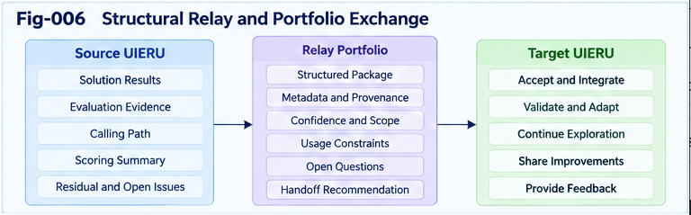

# UIERU-007 — Structural Relay, Provenance, and Intelligence Portability

**Project:** Universal Intelligence Evolution and Relay Unit (UIERU)  
**Authors:** Sizhe Tan & GPT-Obot  
**Version:** 1.0.0  
**Status:** Research architecture and engineering proposal; interfaces and performance claims require validation  
**Series:** UIERU Research Papers · 007

## Abstract

Intelligent work rarely ends when an individual task completes. A successor may need to reproduce a result, understand why a route was chosen, inspect rejected alternatives, recover from failure, or adapt a useful method to a different environment. Conventional handoffs often transfer only an answer, document, or tool invocation. They omit the conditions under which a result was obtained and the evidence required to reuse it responsibly. This paper develops **structural relay** for the Universal Intelligence Evolution and Relay Unit (UIERU): a contract-governed transfer of executable or descriptive structure, decision rationale, provenance, uncertainty, counter-evidence, and candidate improvements between intelligence units. We define a relay envelope and a richer trail portfolio; distinguish portability of information, behavior, evaluation, and authority; specify provenance and localization requirements; and outline verification, acceptance, rejection, and feedback protocols. We argue that intelligence portability is not binary: an artifact can be syntactically portable yet semantically inapplicable, operationally unsafe, or unauthorized. The proposed design makes these differences explicit. Its effectiveness remains a testable engineering hypothesis, not an established universal result.

**Keywords:** structural intelligence; UIERU; structural relay; provenance; intelligence portability; Calling Path; Scoring Forest; relay portfolio; counter-evidence; localization; collective learning; governed evolution

---

## 1. Why an Answer Is Not Enough

Consider a neighborhood lawn-service operator who finishes a job and passes the account to another crew. A note reading *“Completed at 3 p.m.”* conveys a result but not the gate code authorization, rain-related route change, equipment limitation, customer's mowing-height preference, photographic evidence, or the untested alternative schedule. A replacement crew cannot safely infer these facts from the completion status.

The same problem appears in software engineering, scientific research, enterprise workflows, and AI-agent orchestration. A final answer may be correct, yet its portability is limited when the recipient lacks:

1. **Context:** what problem was actually solved, under which assumptions?
2. **Authority:** which actions were permitted, and by whom?
3. **Path:** which decisions, tools, and interventions produced the result?
4. **Evidence:** what observations support the claimed outcome?
5. **Alternatives:** what was rejected, failed, or left unresolved?
6. **Adaptation conditions:** what must change before reuse elsewhere?

A structural relay aims to preserve the minimum sufficient information for a recipient to **inspect, verify, localize, and—if authorized—continue or improve** the work. It is neither unrestricted copying nor automatic delegation.

## 2. Canonical UIERU and the Relay Boundary

A UIERU is modeled as:

$$
U = (K, P, F, R, E)
$$

where:

- **K — Contract:** task semantics, subject and object boundaries, objectives, permissions, constraints, resources, and acceptance criteria.
- **P — Calling Path:** ordered or branching actions, tool calls, human interventions, state transitions, and execution traces.
- **F — Scoring Forest:** forward guidance, multi-perspective evaluation, risk assessment, online control, and settlement.
- **R — Relay:** packaging, transfer, receipt, verification, localization, and handoff of structural information.
- **E — Evolution:** evidence-driven revisions, multi-trail exploration, validation, versioning, and rollback.

The relay boundary connects units without collapsing their identities or decision rights. A sender can **propose** a reusable route; it cannot thereby grant the recipient new privileges. A recipient can **accept** evidence without accepting the sender's scoring policy, executable steps, or authority claims.

The central distinction is:

> **A structural relay transfers inspectable intelligence resources, not automatic obedience or universal validity.**

## 3. Four Layers of Intelligence Portability

Portability is often treated as a single property. UIERU separates at least four layers:

| Layer | Transferable object | Necessary condition | Typical failure |
|---|---|---|---|
| Informational | facts, artifacts, observations, explanations | interpretable format and trustworthy source | missing context or corrupted record |
| Procedural | Calling Path, reusable workflow, tool contract | compatible capabilities and environment | unavailable tool or changed API |
| Evaluative | scoring rules, trade-offs, uncertainty, counter-evidence | comparable objectives and declared perspective | recipient values different outcomes |
| Institutional | permissions, ownership, accountability, obligations | explicit local authorization and applicable policy | unauthorized execution or privacy breach |

A recipient may import an informational record while refusing the other three layers. **Institutional portability is never inferred merely from successful procedural transfer.**

We can describe conditional portability as:

$$
operatorname{Portable}(a, B) =
operatorname{Readable}(a,B) \land
operatorname{Compatible}(a,B) \land
operatorname{Authorized}(a,B) \land
operatorname{Verifiable}(a,B)
$$

Here \(a\) is a proposed artifact and \(B\) a receiving context. This conjunction is a conceptual acceptance criterion, not a claim that each term has a universal numeric metric. Some artifacts can be retained as *reference-only* even when execution portability fails.

## 4. What Exactly Should Be Relayed?

A useful relay separates the **envelope**, which describes the handoff, from the **portfolio**, which carries substantive content.

### 4.1 Relay envelope

The envelope should include:

- identity and version of sender and intended recipient;
- purpose of transfer and correlation to the originating task;
- schema version, content types, and integrity references;
- authority scope, access restrictions, and retention expectations;
- transfer timestamp and status;
- references to evidence and provenance manifests;
- requested recipient action: review, continue, compare, adapt, or archive.

### 4.2 Relay portfolio

The portfolio may contain:

- a **selected trail** and its outcome;
- **alternative trails**, including explored but rejected candidates;
- **counter-evidence** that challenges the selected result;
- **residuals**: unexplained errors, gaps, unknowns, and unmet constraints;
- a **scoring record** with perspective, criteria, uncertainty, and decision rationale;
- **structural deltas** proposed for future use;
- **validation artifacts** and their limitations;
- **dependencies** required to reproduce or adapt the result.

Not every handoff needs every field. The design goal is **selective, purpose-limited completeness**: preserve what a recipient needs without copying private, irrelevant, or excessive material.

## 5. A Canonical Relay Record

The following YAML is illustrative, not a ratified standard. Identifiers, hashes, and schemas are examples; implementations must define their own canonical serialization and verification rules.

```yaml
relay:
  schema: "uieru.relay/0.1-proposal"
  relay_id: "relay-job-184"
  source_unit: "lawn-service-scheduler/v2"
  destination_unit: "field-crew-dispatch/v1"
  task_ref: "job-184"
  purpose: "review-and-continue"
  issued_at: "2026-10-20T14:00:00Z"
  authority:
    permitted_uses: ["read", "review", "propose-plan"]
    execution_authority_transferred: false
    sensitive_fields_redacted: true
  contract:
    objective: "Complete authorized lawn maintenance"
    constraints: ["weather-safe", "customer-approved-window"]
    acceptance: ["customer-confirmation", "completion-evidence"]
  portfolio:
    selected_trail:
      id: "trail-A"
      status: "proposed"
      steps: ["confirm-access", "check-weather", "dispatch-crew"]
    alternatives:
      - id: "trail-B"
        status: "deferred"
        reason: "higher travel time"
    counter_evidence:
      - id: "weather-alert-7"
        claim: "rain may invalidate afternoon schedule"
        status: "unresolved"
    residuals:
      - "customer access confirmation pending"
    scoring:
      perspective: "dispatch-efficiency-with-safety-gates"
      criteria: ["safety", "service-window", "travel-cost"]
      uncertainty: "forecast may change"
    candidate_deltas:
      - id: "delta-rain-gate"
        proposal: "recheck weather before dispatch"
        validation_status: "not-validated"
  provenance:
    manifest_ref: "manifest-job-184.json"
    evidence_refs: ["weather-source-7", "customer-request-184"]
  recipient_requirements:
    verify_manifest: true
    confirm_local_authority: true
    recheck_weather: true
```

This record does **not** authorize dispatch. It asks the receiving unit to verify the context and obtain its own permission before external action.

## 6. Provenance as a Structural Requirement

Provenance is more than a source citation. For a relayed decision, the recipient may need to distinguish:

- **Origin:** which actor, model, tool, or sensor generated an assertion?
- **Transformation:** how was raw evidence filtered, summarized, scored, or folded?
- **Temporal validity:** when was it observed, and when might it expire?
- **Dependency:** which decisions rely on the assertion?
- **Confidence and contestation:** what corroboration or counter-evidence exists?
- **Custody:** who transmitted or modified the artifact?

A minimal provenance event can be represented as:

$$
p_i = (actor, operation, inputs, outputs, time, context, evidence)
$$

A chain of these events forms a provenance graph rather than merely a flat log. Graph edges may represent *derived-from*, *used-by*, *challenged-by*, and *superseded-by* relationships.

### 6.1 Integrity is not truth

Cryptographic hashes or signatures can establish that an artifact has not changed since a known signing event. They do **not** establish that the original observation was accurate, that the signer was trustworthy, or that the conclusion is valid in the recipient's environment. UIERU should therefore distinguish:

1. **Integrity verification** — bytes and signatures match expected references.
2. **Authenticity and authorization checks** — origin and permissions are acceptable.
3. **Evidence assessment** — observations and inferences are sufficiently supported.
4. **Contextual applicability** — the information remains relevant here and now.

### 6.2 Privacy-preserving provenance

A full trace may expose personal data, secrets, customer records, or proprietary prompts. Implementations should support selective disclosure, redaction, reference-based access, retention limits, and auditable reasons for withholding information. A recipient should be told that evidence was withheld, rather than silently treating an incomplete portfolio as exhaustive.

## 7. Relay Semantics: Copy, Continue, Adapt, and Learn

A receiving UIERU may use an artifact in several distinct ways:

| Mode | Recipient action | Primary obligation |
|---|---|---|
| Reference | read and compare | preserve attribution and uncertainty |
| Continuation | resume an interrupted path | verify current state and authority |
| Reproduction | repeat a documented procedure | verify dependencies and assumptions |
| Localization | adapt to local constraints and tools | record deviations and new tests |
| Learning | extract a reusable principle or delta | independently evaluate generalization |

These modes should be explicit in the receiving contract. **Reproduction is not equivalent to validity, and adaptation is not equivalent to permission.**

## 8. Localization Before Execution

Suppose a software-engineering UIERU receives a tested deployment workflow from another organization. Its repository layout, cloud credentials, approval chain, threat model, and rollback mechanisms differ. The received path may be informative, but executing it unchanged could be unsafe.

Localization is the controlled transformation:

$$
L_B(a, K_B, Env_B) \rightarrow (a_B, \Delta_B, Q_B)
$$

where \(a\) is the incoming artifact, \(K_B\) the receiving contract, \(Env_B\) the local environment, \(a_B\) the adapted candidate, \(\Delta_B\) the recorded changes, and \(Q_B\) the outstanding validation questions.

A safe localization workflow:

1. Parse and validate the envelope and content schema.
2. Confirm provenance and permitted uses.
3. Map required tools, names, types, resources, and environment assumptions.
4. Reconcile the incoming objectives with the recipient's contract.
5. Re-evaluate scoring perspectives, uncertainty, and counter-evidence.
6. Test the adapted path in an appropriate sandbox.
7. Request explicit authorization before consequential execution.
8. Preserve adaptation deltas for subsequent audit and relay.

A **local refusal** is a valid outcome. The relay succeeds as communication even when execution is rejected.

## 9. From Trail History to Relay Portfolio

A single “winning path” is often a lossy summary of a multi-trail search. Suppose three sandbox tracks were evaluated:

- **Exploit trail:** uses a proven method and meets baseline criteria.
- **Explore trail:** discovers a cheaper alternative but lacks sufficient evidence.
- **Challenge trail:** identifies a rare failure mode in the exploit method.

A conventional workflow might export only the exploit result. A UIERU relay portfolio can preserve the explore candidate and the challenge evidence without declaring either to be operationally ready.

This matters for **future option value**: an alternative that is inferior under today's constraints may become useful after a resource, tool, regulation, or objective changes. Yet storing every trial indefinitely is impractical. The portfolio therefore needs evidence-aware selection, deduplication, retention policies, and retrieval indexing.

### 9.1 Portfolio selection criteria

Candidate inclusion can be guided by:

- impact on the current conclusion;
- novelty relative to already retained structures;
- reproducibility and provenance quality;
- uncertainty or counter-evidence significance;
- expected reuse under plausible future contexts;
- privacy, storage, and transfer cost.

A heuristic priority score may help rank candidates, but **hard constraints** such as privacy, authority, and safety must remain gates, not compensable score terms.

---



*Figure 6. Contract-governed relay envelope and evidence-aware portfolio exchange, showing provenance, alternative trails, counter-evidence, recipient localization, verification, and bidirectional feedback.*

---

## 10. Forward Scoring Forest at the Handoff

The Scoring Forest is not merely a retrospective evaluator. It can guide relay decisions before transfer:

- **What to package:** prioritize evidence and alternative trails relevant to the recipient's intended use.
- **When to relay:** detect milestones, uncertainty thresholds, authority transitions, and handoff deadlines.
- **Whom to relay to:** compare recipient capability, compatibility, workload, and permissions.
- **How much to relay:** trade explanatory sufficiency against cost, sensitivity, and cognitive overload.
- **When to stop:** reject a transfer if essential context or authority is absent.

After receipt, the receiving forest may use different criteria. A sender's efficiency score is not binding on a recipient whose primary concern is safety or regulatory compliance.

This yields a **two-perspective relay evaluation**:

$$
F_A(transfer\_value, transfer\_risk) \quad \text{and} \quad
F_B(local\_fit, local\_risk)
$$

The two perspectives need not collapse into one scalar. A useful protocol exposes their differences and resolves them through contracts, negotiation, or rejection.

## 11. Relay Lifecycle and Acknowledgment

A proposed state machine is:

```text
PREPARE
   |
   v
PACKAGE --(missing evidence)--> HOLD / REVISE
   |
   v
OFFER --(rejected)-----------> REJECTED / ARCHIVED
   |
   v
RECEIVED
   |
   v
VERIFY --(invalid)----------> QUARANTINED / REJECTED
   |
   v
LOCALIZE --(incompatible)---> REFERENCE_ONLY / REJECTED
   |
   v
ACCEPTED_FOR_DEFINED_USE
   |
   v
TEST / AUTHORIZE / EXECUTE (as permitted)
   |
   v
FEEDBACK / DELTA / PROVENANCE UPDATE
```

**Acknowledgment levels** should be differentiated:

- *Received:* bytes or references arrived.
- *Verified:* integrity, format, and source checks passed.
- *Understood:* semantics and required dependencies were resolved.
- *Accepted:* a specific use was authorized under the recipient contract.
- *Validated:* an outcome or adaptation passed defined tests.

A receipt acknowledgment is not proof of semantic understanding or permission to execute.

## 12. Reference Algorithm: Evidence-Aware Structural Relay

```text
function structural_relay(sender, recipient, task, portfolio):
    purpose = negotiate_purpose(sender.contract, recipient.contract)
    if purpose is None:
        return REJECT("No compatible transfer purpose")

    selected = select_relevant_trails(portfolio, purpose)
    package = build_envelope_and_portfolio(
        contract=sender.contract,
        selected_trails=selected,
        include_provenance=True,
        include_counter_evidence=True,
        include_residuals=True,
        include_uncertainty=True
    )
    package = redact_and_limit(package, sender.data_policy)
    if not package.has_minimum_evidence_for(purpose):
        return HOLD("Insufficient transfer evidence")

    transmit(package)
    receipt = recipient.verify_format_integrity_and_origin(package)
    if not receipt.ok:
        return REJECT_WITH_REASON(receipt.reason)

    permissions = recipient.check_local_authority(package, purpose)
    if not permissions.ok:
        return REFERENCE_ONLY_OR_REJECT(permissions.reason)

    adapted, delta, questions = recipient.localize(package)
    if questions.block_execution:
        return HOLD_WITH_QUESTIONS(questions)

    validation = recipient.test(adapted)
    if not validation.passes:
        return REJECT_OR_REVISE(validation, delta)

    # Execution remains a separate, explicit authorization decision.
    return ACCEPT_FOR_USE(adapted, purpose, validation, delta)
```

The algorithm deliberately separates **acceptance of information** from **authorization of action**. Its functions are conceptual contracts requiring implementation-specific schemas, trust policies, and failure handling.

## 13. Composition and Cross-Organizational Relay

Structural relay must work across several boundaries:

**Within one unit:** a planner hands evidence to an executor or evaluator.

**Between sibling units:** one software agent passes a tested component and known limitations to another.

**Between parent and child units:** a parent delegates a bounded contract; the child returns evidence, residuals, and proposed deltas.

**Between organizations:** parties exchange a constrained subset of their intelligence portfolio while retaining separate governance, ownership, and scoring sovereignty.

Nested UIERUs add a challenge: provenance and permissions can be obscured by summarization. A parent may fold multiple child outputs for efficient relay, but should preserve links to critical underlying evidence, conflicts, and unresolved constraints. This is **evidence-preserving folding**, not unrestricted flattening.

## 14. Failure Modes and Defensive Design

| Failure mode | Consequence | Proposed safeguard |
|---|---|---|
| Lost context | incorrect reuse | explicit assumptions and dependencies |
| Stale evidence | invalid decisions | timestamps, expiry checks, revalidation |
| Authority laundering | unauthorized action | recipient-side authorization gates |
| Provenance spoofing | misplaced trust | origin verification and source assessment |
| Score laundering | imported priorities override local goals | perspective tags and local rescoring |
| Over-compression | counter-evidence disappears | evidence links and loss declarations |
| Portfolio overload | high cost, low usability | relevance selection and tiered storage |
| Sensitive-data leakage | privacy or security harm | redaction, least privilege, access controls |
| Recursive error propagation | bad methods spread through network | independent validation and rollback |
| Schema drift | silent misinterpretation | version negotiation and compatibility tests |
| False confidence | unvalidated candidate treated as proven | explicit status and evidence thresholds |

No single metadata field eliminates these risks. Their mitigation depends on process, enforcement, and empirical evaluation.

## 15. Minimal Interoperability Contract

A proposed **relay conformance profile** should test whether an implementation can:

1. Identify sender, recipient, purpose, and schema version.
2. Distinguish observation, inference, proposal, and validated outcome.
3. Declare authority scope and prevent implicit transfer of execution rights.
4. Trace selected claims to provenance references.
5. Preserve or explicitly disclose omission of consequential counter-evidence.
6. Mark alternative trails by status: explored, rejected, deferred, untested, validated.
7. Express uncertainty and temporal validity where material.
8. Detect missing dependencies and incompatible interfaces.
9. Support acceptance, reference-only, quarantine, and rejection outcomes.
10. Record localization changes and recipient-side tests.
11. Emit acknowledgment levels without overstating what was verified.
12. Preserve an auditable chain across subsequent relays and revisions.

These are **candidate engineering requirements**, not an assertion that an industry standard already exists. `SPEC-003-Structural-Relay-and-Portfolio-Exchange.md` is intended to develop them into machine-testable contracts.

## 16. A Worked Example: Software Engineering Relay

A UIERU coordinates a security-sensitive software change. Three tracks run in isolated sandboxes:

- **Trail A:** minimal patch, passes ordinary tests.
- **Trail B:** larger refactor, improves maintainability but introduces integration risk.
- **Trail C:** adversarial tests, reveals a boundary-case failure in Trail A.

The sender chooses a revised patch based on Trail A and the counter-evidence from Trail C. The relay package includes the patch reference, test logs, environment manifest, security findings, rejected refactor rationale, unresolved performance concern, and proposed regression-test delta.

A receiving release-management UIERU verifies the provenance, maps dependencies to its own build environment, reruns tests, and applies its separate release policy. It may reject deployment despite the sender's positive score. The receiver then relays its test outcome and any new failures back to the development unit.

**What becomes portable is not just the patch, but an inspectable record of the work and the conditions of justified reuse.**

## 17. Bidirectional Relay as a Learning Loop

Relay is often drawn as a one-way arrow from producer to consumer. For structural learning, the more useful pattern is bidirectional:

```text
Source UIERU                      Receiving UIERU
   |                                    |
   |-- contract + portfolio ---------->|
   |                                    | verify
   |                                    | localize
   |                                    | test / use
   |<-- feedback + counter-evidence ----|
   |<-- candidate structural delta -----|
   |                                    |
   | evaluate, accept/reject, version   |
```

The receiving unit contributes **new context-dependent evidence**, not automatic proof of global improvement. A source unit may incorporate feedback only after checking provenance, compatibility, and potential regressions. Conversely, a recipient may learn from the source while retaining its own scoring criteria and subject boundaries.

This mechanism is a building block for the collective-learning ecosystems examined in **UIERU-008**, but no network-wide intelligence gain is guaranteed.

## 18. Falsifiable Research Hypotheses

**H1 — Context retention.** Compared with result-only handoffs, structured relay portfolios reduce the rate of context-related errors in downstream continuation tasks.

**H2 — Reuse under change.** Explicit dependencies, uncertainty, and localization records improve safe reuse when tools or operating conditions differ.

**H3 — Counter-evidence preservation.** Portfolios retaining relevant rejected trails and counter-evidence improve detection of latent failures compared with winner-only transfers.

**H4 — Provenance and auditability.** Provenance-aware relays shorten root-cause analysis time without unacceptable increases in processing and storage costs.

**H5 — Governance preservation.** Recipient-side contract and authority checks reduce unauthorized actions relative to workflows that treat imported instructions as executable authority.

**H6 — Collective improvement.** Bidirectional feedback increases validated reuse of structural improvements over one-way artifact distribution, when independent validation and rollback are enforced.

Each hypothesis can fail. In some environments, the added complexity may exceed its benefit.

## 19. Evaluation Design and Baselines

A rigorous study should compare at least four handoff conditions:

- **B0 — Result only:** final answer or artifact with minimal context.
- **B1 — Conventional log:** result plus execution history.
- **B2 — Provenance handoff:** log plus source and dependency metadata.
- **B3 — UIERU structural relay:** contract, selected trails, provenance, counter-evidence, uncertainty, localization, and feedback.

Use matched tasks with controlled perturbations: stale data, changed APIs, missing permissions, contradictory evidence, cross-organization transfer, and delayed continuation. Randomize handoff condition where feasible, and separate human/AI evaluator judgment from the system's own scoring forest.

**Primary measures:** downstream task success, unsafe-action rate, time to recovery, transfer fidelity, reproducibility, counter-evidence detection, and validated structural reuse.

**Cost measures:** bytes transferred, storage, latency, compute, human review burden, privacy exposure, and interface-maintenance effort.

**Ablations:** remove alternative trails, remove provenance, remove recipient-side rescoring, or remove feedback; observe which components actually contribute. Report negative results and conditions under which lightweight handoffs are superior.

## 20. Boundaries, Non-Claims, and Open Problems

The architecture does **not** claim that:

- all intelligence can be fully serialized;
- every useful skill is expressible as a Calling Path;
- portable evidence is necessarily trustworthy;
- a sender's objective function should govern the recipient;
- multi-trail portfolios always justify their storage cost;
- provenance alone ensures safety or correctness;
- relayed structural deltas necessarily improve the receiving unit;
- every workflow needs a UIERU wrapper.

Open engineering questions include the minimum sufficient relay record; efficient provenance compression; handling tacit human expertise; semantic compatibility across models and organizations; trust negotiation; provenance under privacy restrictions; portfolio retrieval at scale; and prevention of correlated errors spreading through a collective network.

## 21. Implications for the UIERU Research Program

Structural relay links the earlier papers' mechanisms into an inter-unit engineering process. **UIERU-002** defines the canonical contract; **UIERU-003** explains execution and scoring duality; **UIERU-004** and **UIERU-005** develop multi-trail guidance and counter-evidence; **UIERU-006** addresses composition and nested authority. The present paper defines how their outputs can cross boundaries without discarding essential evidence or overriding local sovereignty.

The next paper, **UIERU-008 — Bidirectional Collective Learning and Relay Ecosystems**, examines what changes when many such relays form a network of independent contributors and recipients.

## 22. Conclusion

The practical value of a UIERU is not exhausted by task completion. Its longer-term potential lies in making the **structure of intelligent work** inspectable, transferable, and conditionally reusable. A governed structural relay packages contracts, Calling Paths, scoring perspectives, provenance, alternative trails, counter-evidence, residuals, and candidate deltas into a recipient-verifiable portfolio. It preserves the distinction between *receiving information*, *accepting an evaluation*, and *authorizing an action*.

The resulting vision is neither a universal serialization of intelligence nor a mandate to containerize every workflow. It is an engineering proposal for selective, evidence-aware intelligence portability—one that can be measured against simpler handoffs and rejected where its complexity is not justified.

---

## Series Context and Related Research

This paper is self-contained; the UIERU series offers progressively deeper treatments of contracts, guidance, sandboxes, and composition. Related engineering concepts include workflow orchestration, distributed tracing, event sourcing, data provenance, reproducible research, software supply-chain attestations, and policy-based access control. These provide relevant design precedents, but no claim of equivalence or universal interoperability is made here.

**Suggested citation:** Tan, Sizhe, and GPT-Obot. (2026). *UIERU-007: Structural Relay, Provenance, and Intelligence Portability*. Universal Intelligence Evolution and Relay Unit, v1.0.0. DOI pending.

**License:** See repository-level license and citation metadata.
