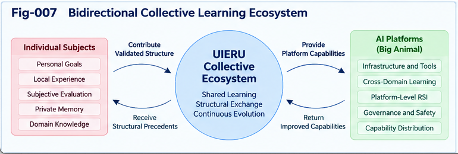

# UIERU-008 — Bidirectional Collective Learning and Relay Ecosystems

**Project:** Universal Intelligence Evolution and Relay Unit (UIERU)  
**Version:** 1.0.0  
**Authors:** Sizhe Tan & GPT-Obot  
**Status:** Research architecture and testable proposals  
**Repository path:** `docs/UIERU-008-Bidirectional-Collective-Learning-and-Relay-Ecosystems.md`

> **Engineering First · Theory Supported · Research Open**  
> No prerequisite DOI is required to understand this paper.

## Abstract

An intelligent execution unit becomes more valuable when its validated experience can be reused elsewhere and when it can learn from experiences produced by others. This paper develops **bidirectional collective learning** for the Universal Intelligence Evolution and Relay Unit (UIERU): an organizational structure that combines a governed Calling Path, a forward-guiding Scoring Forest, evidence-bearing relay, and controlled structural evolution. Rather than treating collaboration as message exchange or shared model weights alone, the proposed ecosystem exchanges **portable, provenance-aware intelligence portfolios**: executable or adaptable procedures, contracts, scoring perspectives, evidence, counter-evidence, failures, uncertainty, and candidate structural improvements. The receiving unit independently localizes and validates incoming material, preserving its authority and evaluation sovereignty. The originating unit may then learn from acceptance, adaptation, rejection, and newly observed residuals. We describe the architecture, exchange protocols, governance, failure modes, evaluation metrics, and falsifiable hypotheses. The architecture is a research proposal, not a claim of demonstrated universal intelligence or guaranteed collective improvement.

**Keywords:** UIERU; structural relay; collective learning; intelligence portability; provenance; localization; forward guidance; scoring forest; multi-trail exploration; counter-evidence; structural evolution.

---



---

## 1. The Engineering Problem: Experience That Does Not Travel

Consider three independent neighborhood lawn-service teams. One discovers that wet grass changes the optimal mowing sequence. Another develops a safer procedure for steep slopes. A third learns that a particular equipment schedule fails when batteries age. If each team merely reports “job complete,” most transferable intelligence disappears. If all teams copy a single standard procedure without checking local conditions, unsafe or ineffective behavior can spread.

A useful exchange must answer five questions:

1. **What was attempted?** The Calling Path, conditions, dependencies, and alternatives.
2. **Why was it selected?** Goals, constraints, Scoring Forest perspectives, and guidance decisions.
3. **What happened?** Outcomes, evidence, failures, and unresolved uncertainty.
4. **Where does it apply?** Preconditions, capability assumptions, environment, and authority boundaries.
5. **What can be learned next?** Candidate changes, counter-evidence, validation requests, and residuals.

UIERU proposes a structured unit that can produce, consume, and refine such exchanges without requiring all participants to adopt the same model, software stack, institution, or worldview.

### 1.1 Core thesis

**Collective learning is not simply sharing answers. It is the governed circulation, localization, testing, and revision of reusable intelligence structures.**

This thesis implies a two-way relationship:

- **Outbound:** a UIERU exports evidence-backed structures and questions discovered during execution.
- **Inbound:** a UIERU imports candidate structures, tests them against its own context and scoring criteria, and returns findings where permitted.

The result is a **relay ecosystem**, not a mandatory centralized brain.

## 2. The Canonical Unit and Its Ecosystem Interface

We retain the canonical abstraction introduced in UIERU-002:

\[
U = (K, P, F, R, E)
\]

where:

| Component | Meaning | Role in collective learning |
|---|---|---|
| **K — Contract** | Goals, subject/authority, object, constraints, permissions, resources | Defines what may be transferred or executed |
| **P — Calling Path** | Executable, delegated, or human-assisted steps and transitions | Carries reusable procedural structure |
| **F — Scoring Forest** | Multiple evaluative perspectives and forward-guidance operators | Explains why a path was selected and how it was controlled |
| **R — Relay** | Portable evidence, state, provenance, interfaces, and handoff | Moves intelligible structures between units |
| **E — Evolution** | Multi-trail exploration, residuals, testing, revision, and rollback | Converts observed differences into candidate improvements |

A unit can be a human-led workflow, a multi-agent process, a software engineering pipeline, or a hybrid service. UIERU **organizes existing intelligence capabilities**; it does not replace them or presume autonomous subjecthood.

An ecosystem is a graph of units and relay relationships:

\[
\mathcal{G} = (\mathcal{U}, \mathcal{L})
\]

Here, \(\mathcal{U}\) is the set of participating units and \(\mathcal{L}\) contains authorized relay channels. These channels may be one-way, reciprocal, time-limited, or mediated by registries. A connected graph does not imply universal trust or uniform scoring.

## 3. From One-Way Handoff to Bidirectional Learning

A traditional handoff transfers a task, document, or result from A to B. Bidirectional relay additionally captures what B learned from using, modifying, or rejecting A's contribution.

```text
Unit A: execution + exploration
  └─ produces Portfolio A (path, guidance, evidence, counter-evidence)
                       │
                       ▼
               Relay / Registry
                       │
                       ▼
Unit B: receive → inspect → localize → sandbox → evaluate
                       │
           ┌───────────┴────────────┐
           ▼                        ▼
      Adopt / adapt           Reject / defer
           │                        │
           └───────────┬────────────┘
                       ▼
        Feedback Portfolio B→A
        (evidence, deltas, residuals)
                       │
                       ▼
Unit A: re-evaluate → version → re-publish or withdraw
```

The feedback path is as important as the forward path. A rejected procedure may reveal a previously unknown environmental constraint; a locally modified procedure may reveal a more generalizable principle. However, feedback is not automatically accepted as truth: it remains attributed evidence requiring interpretation.

### 3.1 Four distinct exchange objects

1. **Outcome:** a result and its evidence.
2. **Procedure:** a Calling Path with dependencies and preconditions.
3. **Evaluation:** scoring perspectives, risk criteria, uncertainty, and rationale.
4. **Evolution candidate:** a proposed change with supporting and conflicting evidence.

These objects have different transfer and validation requirements. An outcome may be portable as information while its original procedure is not executable at the destination. An evaluation perspective may be useful for comparison without becoming the receiver's governing policy.

## 4. Relay Portfolio: The Unit of Collective Exchange

The ecosystem exchanges a **Relay Portfolio**, not an opaque “best answer.” Its minimum conceptual contents are:

| Field | Purpose |
|---|---|
| Identity and version | Distinguish source, lineage, and compatible revisions |
| Source contract | Record original goals, permissions, and constraints |
| Capability assumptions | State tools, environment, skills, and dependencies |
| Calling Path | Describe actions, transitions, exceptions, and checkpoints |
| Guidance record | Capture forward decisions and scoring perspectives |
| Evidence ledger | Link observations to claims and methods |
| Counter-evidence | Preserve disconfirming cases and competing explanations |
| Trail portfolio | Include alternatives, failed or paused trails, and resource costs |
| Residual register | Describe unresolved gaps and surprising outcomes |
| Structural deltas | Propose candidate improvements with verification status |
| Usage restrictions | Specify access, privacy, safety, licensing, and export limits |
| Feedback endpoint | Identify an authorized return channel, if one exists |

A portfolio is **evidence-preserving** when it avoids compressing away information necessary to challenge or reproduce its claims. Full raw data need not be included when prohibited or impractical; the portfolio can carry references, redacted summaries, hashes, and explicit evidence limitations.

### 4.1 Illustrative YAML exchange

```yaml
uieru_relay_portfolio:
  schema_version: "0.1-proposal"
  portfolio_id: "lawn-service-slope-procedure-004"
  origin:
    unit_id: "team-a-unit-12"
    version: "1.3"
    provenance_ref: "evidence-ledger-2026-10-18"
  contract:
    goal: "Complete residential lawn service safely"
    authority: "Local supervisor approval required"
    prohibited_actions:
      - "Operate outside approved slope limits"
  applicability:
    preconditions:
      - "Equipment slope rating verified"
      - "Ground conditions inspected"
    unknowns:
      - "Performance in sustained heavy rain"
  calling_path:
    stages:
      - "Inspect terrain and conditions"
      - "Choose approved equipment and route"
      - "Execute with stop checkpoints"
      - "Verify result and record observations"
  scoring_forest:
    perspectives:
      - "Operator safety"
      - "Task quality"
      - "Time and equipment cost"
    precedence:
      - "Safety constraints override efficiency preferences"
  trails:
    accepted: ["route-b"]
    rejected:
      - trail: "route-a"
        reason: "Unsafe incline under observed conditions"
  evidence:
    supporting: ["inspection-14", "trial-22"]
    counter: ["trial-19-slip-event"]
    limitations: ["Small sample; local conditions only"]
  residuals:
    - "Uncertain transfer to different mower models"
  structural_delta:
    proposal: "Add pre-execution slope checkpoint"
    status: "candidate_not_globally_validated"
  relay_policy:
    sharing_scope: "approved-partners"
    receiver_must_validate: true
    feedback_allowed: true
```

This is an **illustrative schema**, not a finalized interoperable standard. The normative schema belongs in `SPEC-003-Structural-Relay-and-Portfolio-Exchange.md`.

## 5. Localization: Transfer Without Blind Adoption

A received portfolio should pass through a receiver-controlled localization pipeline:

\[
\text{Receive} \rightarrow \text{Verify} \rightarrow \text{Map} \rightarrow
\text{Sandbox} \rightarrow \text{Evaluate} \rightarrow \text{Authorize}
\]

**Verify:** confirm origin, integrity, declared scope, and available evidence.  
**Map:** translate tools, roles, types, units, interfaces, and local environmental assumptions.  
**Sandbox:** test a candidate path in a bounded environment where feasible.  
**Evaluate:** apply local Scoring Forest perspectives and non-negotiable constraints.  
**Authorize:** decide to adopt, adapt, reject, or defer; preserve the decision record.

A unit may learn *about* a foreign procedure without ever being authorized to execute it. Similarly, a receiver may adopt a general principle but reject the originating organization's specific scoring weights.

### 5.1 Sovereignty invariant

**No external portfolio can unilaterally expand a receiving unit's authority or overwrite its hard constraints.**

This is an architectural requirement, not an emergent property that can be assumed without enforcement. Implementations must test for privilege escalation, hidden dependencies, and conflicting contractual obligations.

## 6. Collective Learning as an Evidence-Driven Loop

Let \(H_i\) denote unit \(i\)'s local store of accepted structures, hypotheses, and evidence. A received portfolio \(r\) is not automatically inserted into \(H_i\). Instead:

\[
H_i^{t+1} = \operatorname{Update}(H_i^t,\operatorname{Validate}_i(r),e_i)
\]

where \(e_i\) is local evidence and \(\operatorname{Validate}_i\) is receiver-specific. `Update` may preserve a rejected candidate as counter-evidence rather than discarding it.

A bidirectional learning cycle consists of:

1. **Produce:** execute a task or exploration trail and record evidence.
2. **Package:** export an authorized, versioned portfolio.
3. **Discover:** match portfolio contracts and capability descriptors to potential receivers.
4. **Localize:** reconcile environmental and authority differences.
5. **Challenge:** run sandbox tests, adversarial trails, or counterfactual checks.
6. **Decide:** accept, adapt, reject, or defer with an explanation.
7. **Return:** send permitted evidence and deltas to source and peers.
8. **Govern:** revise, deprecate, roll back, or retain competing variants.

The process supports collective learning even if no common model weights are updated. It also supports future weight updates where independently justified; those are optional, not definitional.

## 7. Forward Guidance Across the Network

Scoring Forests are not limited to scoring completed relay packages. They can **guide which questions, partners, and experiments to pursue next**.

At a unit level, forward guidance selects Calling Path candidates. At an ecosystem level, it may prioritize:

- Which external portfolios to inspect.
- Which residuals deserve collective investigation.
- Which counter-evidence requests are most informative.
- Which localizations are likely to succeed.
- Which exploratory trails justify scarce sandbox resources.
- Which uncertain conclusions should be withheld from broad dissemination.

A conceptual relay-selection objective is:

\[
\operatorname{Priority}(r,i) =
\operatorname{Benefit}_i(r) + \lambda\operatorname{InformationGain}_i(r)
- \mu\operatorname{Cost}_i(r) - \rho\operatorname{Risk}_i(r)
\]

subject to hard authorization, privacy, and safety constraints. This is an illustrative decision model, not a universally valid metric. Some dimensions may be incomparable; **perspective-aware folding** should preserve veto conditions and material uncertainty instead of collapsing everything into one scalar.

### 7.1 Ecosystem-level Multi-Trail exploration

An unresolved question can be distributed as a **trail portfolio**:

- **Exploit trail:** test the strongest current procedure in a new setting.
- **Explore trail:** search for an alternative structure or procedure.
- **Challenge trail:** attempt to falsify the current assumption.

Participating units can run different trails under their own contracts and return evidence. This is a structured form of distributed inquiry, not a requirement for uncontrolled autonomous experimentation.

## 8. Collective Memory Without a Single Global Authority

A relay ecosystem needs discoverability but does not necessarily need centralized governance. Possible designs include:

| Architecture | Advantage | Principal risk |
|---|---|---|
| Central registry | Easy search, indexing, and version discovery | Bottleneck and governance concentration |
| Federated registries | Institutional autonomy and domain specialization | Schema and identity interoperability |
| Peer-to-peer exchange | Flexible bilateral collaboration | Discovery, trust, and consistency complexity |
| Hybrid network | Central discovery with local authority and storage | More complex coordination |

The recommended starting point is **hybrid**: shared metadata and stable relay contracts, with local control of execution, private evidence, and acceptance decisions.

A **Structural Precedent Registry** may index reusable cases, verified deltas, applicability conditions, and counterexamples. Entries should distinguish:

- Proposed versus tested versus locally accepted versus broadly replicated.
- Current versus deprecated versus withdrawn.
- Source claims versus independently reproduced findings.
- Evidence availability versus evidence absence.

Popularity or reuse count must not be confused with validity.

## 9. Provenance, Trust, and Reputation

Trust in a portfolio is not a single transferable number. It is an assessment of claims under particular contexts. Relevant dimensions include:

1. **Identity confidence:** is the claimed source authenticated?
2. **Integrity:** was the portfolio altered?
3. **Method quality:** how were observations and tests conducted?
4. **Applicability:** do the conditions match the receiver's setting?
5. **Independent replication:** has another unit corroborated the result?
6. **Counter-evidence coverage:** what serious objections have been examined?
7. **Freshness:** have tools, environments, or regulations changed?

Reputation can inform prioritization, but it must not override explicit evidence or authorization. Feedback systems should resist reputation laundering, sybil identities, collusion, and selective reporting of successes.

### 9.1 Provenance graph

A useful evidence model links:

```text
Claim → Observation → Method → Environment → Actor/Tool → Time
  │           │
  ├→ Supporting evidence
  ├→ Counter-evidence
  └→ Revisions / withdrawals
```

This graph permits a receiver to distinguish “the procedure was reported successful” from “the procedure was independently validated here.”

## 10. Scoring Conflict and Perspective-Aware Folding

Collective learning introduces multiple, potentially incompatible Scoring Forests. A hospital, research lab, small business, and autonomous coding system may all value speed, cost, safety, transparency, and reliability differently.

Three principles follow:

**First, hard constraints are not tradeable preferences.** An unsafe action cannot be justified merely because another unit assigns it a high efficiency score.

**Second, scores require context.** A value of 0.9 in one local model is not necessarily comparable to 0.9 in another.

**Third, unresolved conflict can be retained as structure.** Instead of forcing premature consensus, a relay portfolio can preserve separate perspectives, their conditions, and the evidence supporting each.

A folded portfolio should expose both a decision summary and its **unfolding handles**: provenance, assumptions, dissenting evaluations, and unresolved alternatives. This supports future reinterpretation when contexts change.

## 11. Structural Evolution and the Return Path

The distinctive output of bidirectional collective learning is a **candidate structural delta**. Examples include:

- Adding a checkpoint to a Calling Path.
- Revising a tool-selection rule.
- Splitting a broad condition into two more precise cases.
- Introducing a new Scoring Forest perspective.
- Updating a relay contract to expose previously missing evidence.
- Replacing an unreliable path with a locally verified alternative.

The delta lifecycle is:

```text
Residual or counter-evidence
          ↓
Candidate structural delta
          ↓
Compatibility and authority check
          ↓
Sandbox / adversarial validation
          ↓
Local acceptance or rejection
          ↓
Versioned release + rollback plan
          ↓
Optional relay to other units
```

A proposal becomes an **accepted local improvement** only after the required tests pass. Broader applicability requires additional evidence. Rejected or inconclusive deltas remain useful as indexed research artifacts.

### 11.1 Feedback categories

The receiving unit should be able to return:

| Feedback | Meaning |
|---|---|
| `accepted` | Works within specified local conditions |
| `adapted` | Works only after an identified modification |
| `rejected` | Fails a contract, safety, or evidence criterion |
| `inconclusive` | Evidence insufficient for a decision |
| `counterexample` | Specific evidence challenges a claimed generalization |
| `new_residual` | An unresolved gap was exposed |

These labels are scoped, attributable, and reversible; they are not global truth statuses.

## 12. Example: Three Lawn-Service Teams Form a Relay Ecosystem

**Team A** exports a mowing route that reduces equipment idle time on flat properties. Its portfolio includes a route, battery assumptions, observations, and a failure on a steep yard.

**Team B** imports the portfolio. Its properties have different terrain and equipment. B rejects direct execution, adapts the route into two terrain-specific variants, and tests both under supervisor authorization. B sends A the successful modification and the evidence that the original route was unsafe on certain slopes.

**Team C** receives the combined evidence. It notices that battery age predicts route failures better than terrain alone in its setting. C creates a challenge trail and records a counterexample to the emerging generalization.

The ecosystem does not converge automatically on one “universal mowing algorithm.” It develops a richer conditional structure:

```text
IF terrain = flat AND battery_health = good
    consider Route A, subject to local checks
ELSE IF terrain = slope AND approved_equipment = available
    consider Route B with additional safety checkpoint
ELSE
    request local planning; do not auto-adopt
```

This modest example demonstrates the general pattern: **transfer a procedure, discover its boundary, refine its conditions, and return the evidence**.

## 13. Example: Multi-Agent Software Engineering

A software engineering UIERU receives a bug-fix portfolio from another team. The portfolio includes a reproduction script, proposed patch, test results, alternative patches, and an unresolved performance regression.

The receiver:

1. Checks license and repository permissions.
2. Maps dependencies and runtime versions.
3. Reproduces the bug in a sandbox.
4. Runs an exploit trail using the original patch, an explore trail with a simpler fix, and a challenge trail with adversarial tests.
5. Accepts a locally verified fix, but retains the performance counterexample.
6. Returns the counterexample and revised regression test to the source.

This is more informative than sharing only a code diff. The receiving team inherits **a structured investigation**, not an unexplained recommendation.

## 14. Minimal Protocol for Bidirectional Relay

The following is a **reference workflow**, not executable production code:

```python

def receive_and_learn(portfolio, local_unit):
    assert verify_integrity(portfolio)
    if not local_unit.contract.permits_import(portfolio):
        return record_rejection("contract_not_permitted")

    mapped = localize(portfolio, local_unit.capabilities)
    if mapped.has_unresolved_hard_conflicts():
        return record_defer("requires_authorized_reconciliation")

    trials = plan_bounded_trails(
        mapped,
        guidance=local_unit.scoring_forest,
        budget=local_unit.sandbox_budget,
    )
    evidence = run_authorized_sandboxes(trials)
    decision = evaluate_with_local_constraints(evidence, local_unit.contract)

    local_unit.registry.record(portfolio, evidence, decision)
    if decision.approved:
        local_unit.evolution.propose_versioned_delta(decision)

    feedback = build_provenance_aware_feedback(
        portfolio, evidence, decision,
        redact_by_policy=local_unit.contract.export_policy,
    )
    return decision, feedback
```

**Important:** authorization must also govern what is executed inside the sandbox, what information is exported, and whether a candidate change may be deployed. A sandbox is not a substitute for contract enforcement.

## 15. Interoperability and Contract Requirements

A minimal ecosystem profile should define:

- Stable identifiers for units, portfolios, versions, and evidence objects.
- Capability descriptors and typed Calling Path interfaces.
- Contract fields for authority, prohibited actions, resource ceilings, and data-sharing restrictions.
- Scoring perspective metadata, including units, ordering, veto constraints, and uncertainty.
- Provenance references and integrity mechanisms.
- Trail status and outcome vocabulary.
- Localization mapping records.
- Delta proposals, acceptance scope, versioning, and rollback references.
- Feedback permissions, recipient rules, and retention policies.

**Contract-first design** matters because superficially similar data may represent different obligations. For example, a “validated” label must identify *who* validated *what*, *where*, and *against which criteria*.

This paper describes the conceptual requirements. The companion `SPEC-001` through `SPEC-004` documents will provide more precise contracts and conformance tests.

## 16. Safety, Privacy, and Governance

Open relay ecosystems increase the attack surface. Key failure modes include:

| Failure mode | Required control |
|---|---|
| Malicious portfolio or prompt injection | Treat imported instructions as untrusted data; isolate and authorize execution |
| Hidden privilege escalation | Enforce receiving contract and least privilege |
| Data leakage through evidence or feedback | Redaction, access policy, retention limits, audit logs |
| False provenance or fabricated validation | Authentication, integrity checks, reproducibility testing |
| Unsafe overgeneralization | Explicit applicability conditions and local sandbox validation |
| Metric gaming / Goodhart effects | Counter-evidence, multiple perspectives, independent evaluation |
| Feedback loops amplifying error | Lineage tracking, independent replication, diversity of evidence |
| Incompatible licensing or ownership | Policy checks before import, adaptation, and redistribution |
| Version drift and stale procedures | Expiration, deprecation, revalidation, rollback |
| Concentrated registry power | Local acceptance sovereignty, portability, alternative registries |

The design must also support **non-participation**: an organization can execute a UIERU locally without sharing sensitive procedures or participating in a collective network.

## 17. Hypotheses and Evaluation Design

The following claims are **testable hypotheses**, not established results.

### H1 — Relay completeness

Evidence-bearing portfolios will reduce information loss compared with result-only handoffs, measured by downstream reproduction success and the number of critical assumptions recovered.

### H2 — Localized reuse

Receiver-controlled localization and sandbox validation will reduce unsafe or invalid adoption relative to direct copying of shared procedures.

### H3 — Bidirectional improvement

Two-way feedback will improve the quality and applicability of subsequent procedure versions relative to one-way publication, under comparable resources.

### H4 — Counter-evidence retention

Preserving failed and challenge trails will reduce repeated mistakes and premature overgeneralization, at the cost of greater storage and evaluation effort.

### H5 — Forward-guided discovery

Guidance-directed selection of relay partners and experiments will produce more validated improvements per unit cost than unguided or random selection in suitable task domains.

### H6 — Federated governance

Local scoring sovereignty with shared contracts will enable useful exchange across heterogeneous organizations without requiring a globally shared scoring function.

### 17.1 Comparative baselines

| Baseline | Description |
|---|---|
| B0 | No cross-unit sharing |
| B1 | Share final answers or reports only |
| B2 | Share Calling Paths without guidance/evidence portfolios |
| B3 | One-way structured portfolio exchange |
| B4 | Bidirectional portfolio exchange without forward-guided partner/trail selection |
| **UIERU proposal** | Bidirectional portfolios with local validation, multi-trail guidance, and versioned evolution |

Experiments should control for task difficulty, personnel/model capability, budget, number of attempts, and information exposure. Otherwise gains may be attributable to extra compute or additional human attention rather than architecture.

### 17.2 Metrics

- **Transfer fidelity:** fraction of required assumptions, constraints, and evidence retained.
- **Localization success:** proportion of imported structures validated under target conditions.
- **Unsafe adoption rate:** violations or near misses per adoption attempt.
- **Reproducibility:** independent confirmation of claimed outcomes.
- **Validated delta yield:** accepted improvements per experiment or resource unit.
- **Counterexample discovery rate:** meaningful falsifications per challenge budget.
- **Time to useful reuse:** elapsed time from publication to authorized local use.
- **Rollback effectiveness:** recovery time and residual impact after a faulty update.
- **Diversity preservation:** retention of materially distinct successful and unsuccessful variants.
- **Governance overhead:** cost of contract checks, provenance, storage, and audit.

Report failures, negative results, and confidence intervals. A successful prototype does not demonstrate universality.

## 18. Engineering Trade-Offs and Boundaries

UIERU relay is **not always warranted**. A trivial one-off action may not justify a portfolio, registry, and sandbox cycle. High-frequency, low-risk operations may prefer a compact contract and a minimal evidence summary. Some information cannot be transferred because of confidentiality, regulation, licensing, or lack of reliable provenance. Some procedural skills remain tacit and may resist formalization.

Three boundaries deserve particular attention:

1. **Semantic boundary:** a shared field name does not guarantee a shared meaning.
2. **Evaluation boundary:** a scoring perspective is not automatically legitimate for another subject.
3. **Causal boundary:** an observed success does not prove that the transferred procedure caused it.

The appropriate goal is **selective structural containerization**: invest in reusable relay units where expected learning and coordination benefits exceed representation, validation, and governance costs.

## 19. Research Questions

1. What is the minimum Relay Portfolio that preserves decision-relevant evidence?
2. Which aspects of a Scoring Forest can be exchanged without forcing common preferences?
3. How can applicability boundaries be learned from heterogeneous counterexamples?
4. When does bidirectional feedback converge toward better structures, and when does it amplify shared error?
5. What degree of provenance is sufficient for independent validation?
6. How should a network allocate Multi-Trail exploration budgets across participants?
7. Can structurally different UIERUs compose while preserving local authority?
8. What objective measures distinguish genuine structural learning from accumulating more documents?
9. How should a registry represent contradictory but contextually valid procedures?
10. What are the cost and latency thresholds beyond which relay overhead outweighs benefits?

## 20. Position Within the UIERU Research Series

This paper follows the engineering progression:

- **UIERU-001:** from Calling Paths to evolvable units.
- **UIERU-002:** canonical contracts, execution, guidance, and relay.
- **UIERU-003:** Calling Path–Scoring Forest duality.
- **UIERU-004:** forward guidance and Multi-Trail intelligence.
- **UIERU-005:** sandbox threading and counter-evidence.
- **UIERU-006:** composition, nesting, folding, and contract reconciliation.
- **UIERU-007:** structural relay, provenance, and intelligence portability.
- **UIERU-008 (this paper):** bidirectional collective learning and relay ecosystems.
- **UIERU-009:** residual-driven structural evolution and recursive improvement.
- **UIERU-010:** universal architecture, engineering boundaries, and validation.

The next paper examines how returned evidence and residuals become versioned structural improvements, including recursive but governed modification of the guidance and relay mechanisms themselves.

### 20.1 Figure placement

Insert the planned figure immediately after Section 3 or at the beginning of Section 6:

```markdown


*Fig-007. UIERUs exchange provenance-aware Relay Portfolios, localize and validate incoming structures, and return counter-evidence, residuals, and structural deltas through governed bidirectional channels.*
```

## 21. Conclusion

The principal contribution of this paper is an architectural distinction: **a network that passes outputs is not necessarily a network that learns**. Collective learning requires reusable structures, provenance, context-sensitive validation, preserved disagreement, and a governed return path. UIERU proposes a composable interface for these functions while leaving execution technologies, institutional authority, and scoring sovereignty with participating units.

The envisioned ecosystem does not eliminate uncertainty, conflict, or local variation. It makes them visible and potentially productive. Its central research question is whether disciplined bidirectional relay can transform isolated experiences into **validated, portable, and continuously revisable structural intelligence** at acceptable cost and risk.

---

## Related Research and Conceptual Lineage

The proposal is informed by, but not dependent on, established work on distributed systems, workflow orchestration, provenance, continual learning, multi-agent coordination, and federated learning. These traditions address important parts of the problem, but the present architecture combines **forward-guided execution, evidence-preserving relay, receiver sovereignty, and structural delta evolution** into one explicit research object. Whether this combination delivers measurable advantages is an empirical question.

Relevant adjacent concepts include:

- Workflow and service orchestration: executable processes and typed handoffs.
- Federated and distributed learning: cross-participant improvement without mandatory centralization.
- Data and scientific provenance: traceability and reproducibility of claims.
- Continual learning: adaptation across tasks and time.
- Multi-agent planning and search: coordinated alternatives and challenge strategies.
- Assurance and safety cases: claims tied to evidence and constraints.

**Optional project lineage:** the broader Structural Intelligence research program includes Universal Control Planes and Scoring Forest/Folding, Portable Intelligence Units, Structural Intelligence Framework, and Subjective Structural Intelligence. This paper is intentionally self-contained; those projects are not prerequisites.

---

**Suggested citation**  
Tan, Sizhe, and GPT-Obot. (2026). *UIERU-008: Bidirectional Collective Learning and Relay Ecosystems*. In *Universal Intelligence Evolution and Relay Unit*, version 1.0.0. Research manuscript. DOI to be assigned upon release.

**License:** Refer to the repository's `LICENSE` file; no license is asserted by this manuscript alone.
