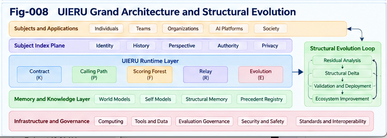

# UIERU-009 — Residual-Driven Structural Evolution and Recursive Improvement

**Project:** Universal Intelligence Evolution and Relay Unit (UIERU)  
**Version:** 1.0.0  
**Authors:** Sizhe Tan & GPT-Obot  
**Status:** Research architecture and testable engineering proposal  
**Companion figure:** `figures/Fig-008-UIERU-Grand-Architecture-and-Structural-Evolution.png`

## Abstract

A capable execution system can complete tasks without becoming better at completing the next task. The Universal Intelligence Evolution and Relay Unit (UIERU) addresses this gap by coupling a governed Calling Path with a forward-guiding Scoring Forest, an evidence-bearing relay interface, and a controlled structural-evolution process. This paper develops the evolution component: how execution residuals, counter-evidence, failed and alternative trails, and relay feedback can become proposed modifications to contracts, paths, scoring policies, and reusable intelligence structures. It distinguishes observations from explanations, hypotheses from validated improvements, and local gains from transferable advances. It proposes an auditable lifecycle—detect, diagnose, propose, sandbox, compare, authorize, deploy, monitor, and rollback—together with bounded recursive improvement, versioned provenance, and empirical tests. Structural evolution is treated as an engineering hypothesis to be evaluated against simpler alternatives, not as a guarantee of open-ended self-improvement.

**Keywords:** UIERU; structural intelligence; residual learning; recursive improvement; Calling Path; Scoring Forest; multi-trail sandbox; counter-evidence; relay; provenance; evaluation governance.

---

## 1. Why Execution Alone Is Not Evolution

Consider a neighborhood lawn-service team. Its Calling Path receives a request, checks the site, estimates work, schedules staff, performs the service, and confirms completion. A Scoring Forest can guide route selection, safety, cost, quality, and customer commitments. Yet a completed job does not necessarily improve the process.

Suppose three jobs repeatedly overrun their estimates because a particular slope requires special equipment. A conventional workflow records the overruns; a reactive optimizer might increase the time estimate. An evolvable intelligence unit should additionally ask:

- Which assumptions failed, and what evidence supports that diagnosis?
- Does the problem concern the execution path, the scoring policy, the contract, or an environmental condition?
- What alternative procedures are available, and how can they be tested safely?
- Under which conditions should an improvement be reused or relayed?
- What observations would disconfirm the proposed improvement?

**The defining distinction is between accumulating execution records and converting justified evidence into governed structural changes.** The latter is the subject of this paper.

## 2. Canonical Unit and Evolution Boundary

We retain the canonical UIERU model introduced in UIERU-002:

\[
U = (K, P, F, R, E)
\]

where:

- **K — Contract:** purpose, subject and authority, inputs, outputs, obligations, constraints, and acceptance conditions.
- **P — Calling Path:** executable or delegable steps, dependencies, tools, actors, and state transitions.
- **F — Scoring Forest:** multi-perspective forward guidance, online control, evidence evaluation, and settlement.
- **R — Relay:** exchange of state, evidence, provenance, alternatives, and candidate structural improvements.
- **E — Evolution:** residual detection, candidate generation, sandbox evaluation, authorization, versioning, monitoring, and rollback.

The unit organizes existing human and machine capabilities; it does not require replacing them. Nor does the existence of an evolution component grant the unit independent authority to modify its own rules. **Every change is bounded by the applicable contract and governance policy.**

### 2.1 What can evolve?

An approved change may target:

| Target | Example | Principal risk |
|---|---|---|
| Contract K | Add slope disclosure to intake | Unapproved change of obligations |
| Calling Path P | Insert equipment suitability check | Latency, operational disruption |
| Scoring Forest F | Adjust slope-risk feature and thresholds | Goodhart effects, hidden trade-offs |
| Relay R | Require evidence of terrain category | Privacy or interoperability regression |
| Evolution E | Improve experiment selection or challenge coverage | Self-referential evaluation bias |
| Composition | Delegate terrain inspection to a specialist unit | Accountability gaps across units |

Changes to the evaluator or evolution policy itself require stronger review than routine task-level tuning, because they can alter the mechanism used to judge subsequent changes.

## 3. Residuals: Signals, Not Ready-Made Explanations

A **residual** is an observed discrepancy between an expected or desired property and a measured outcome, subject to measurement uncertainty and context. Examples include schedule overrun, repeated rework, contract violation, unexpected tool failure, unexplained disagreement among evaluators, or an unanticipated successful alternative.

For metric \(j\), a simple diagnostic residual is:

\[
r_j = y_j - \hat{y}_j
\]

where \(y_j\) is the observed result and \(\hat{y}_j\) is the forecast or reference. This expression is only meaningful when the metric definition, unit, observation window, and uncertainty are preserved.

Residuals may be **negative** (a shortfall), **positive** (unexpected outperformance), **structural** (missing path or interface), **normative** (conflicting requirements), or **epistemic** (insufficient evidence). A residual is not proof of its own cause. In the lawn-service example, an overrun could reflect terrain, weather, staffing, a bad estimate, or an incorrect timestamp.

### 3.1 Residual record

A minimum residual record should include:

1. Expected condition and its provenance.
2. Observed condition and measurement reliability.
3. Task, environment, and contract context.
4. Candidate causes and competing explanations.
5. Impact and urgency.
6. Available counter-evidence and unknowns.
7. Authorized next action.

A scoring anomaly without provenance should be flagged for investigation rather than automatically converted into a new policy.

## 4. From Residual to Structural Delta

A **Structural Delta** is a proposed, versionable modification to a UIERU component or its composition. It is not the residual itself.

\[
\Delta U = (\Delta K, \Delta P, \Delta F, \Delta R, \Delta E)
\]

Most candidates modify only a subset of these elements. For example, a slope-related residual might yield a new terrain-inspection step (\(\Delta P\)) and a conditional equipment-risk criterion (\(\Delta F\)), while leaving the contract unchanged.

Each candidate must specify:

- The problem and supporting evidence.
- The proposed change and affected interfaces.
- The intended operating context and exclusions.
- Predicted benefits, costs, and failure modes.
- Falsification tests and comparison baselines.
- Required authority and compatibility checks.
- Rollback criteria and an immutable parent version.

**A structural candidate is a hypothesis until independent tests justify promotion.**

## 5. Counter-Evidence as a First-Class Evolution Input

Counter-evidence should be collected before and after deployment. An apparent improvement may arise from an easier workload, selective reporting, favorable weather, a metric change, or resource transfers that damage another objective.

For each candidate delta, challenge trails should attempt to identify:

- Conditions where the candidate performs worse than the baseline.
- Objectives that improve only by shifting costs elsewhere.
- Subgroups or operating contexts omitted from the original evaluation.
- Data leakage, confounding, or measurement artifacts.
- Violations of authority, privacy, safety, or contractual obligations.

The Scoring Forest must not silently fold away a severe counterexample because average performance improved. Safety and contractual constraints may operate as hard gates rather than negotiable weighted terms.

## 6. Forward Guidance for Evolution Itself

Forward guidance applies not only to task execution but also to the choice of improvement experiments. Given a portfolio of candidate deltas, the Scoring Forest can rank which uncertainties are most worth reducing, which tests can be performed safely, and when evidence is sufficient to stop.

A conceptual selection objective is:

\[
\operatorname*{select}_{d \in D} \; \mathbb{E}[V(d) \mid H] - C_{test}(d) - \lambda Risk(d)
\]

subject to authorization, safety, resource, and coverage constraints. Here \(H\) denotes current evidence; the formula is a design abstraction, not a universally valid estimator. In practice, uncertainty intervals, veto rules, and non-comparable stakeholder perspectives must be retained rather than forced into a single score.

### 6.1 Multi-trail evolution portfolio

Three complementary trail types are useful:

- **Exploit:** reproduce the established baseline and protect delivery quality.
- **Explore:** test new Calling Paths, scoring features, or delegation structures.
- **Challenge:** search for disconfirming cases, adversarial inputs, and hidden costs.

The system may allocate a small exploration budget while keeping production execution on the approved baseline. Trails can be simulated, sandboxed, or—only when authorized—executed in a limited real environment.

## 7. Governed Evolution Lifecycle

The following lifecycle makes proposed improvement operationally auditable.

| Stage | Output | Exit gate |
|---|---|---|
| 1. Observe | Versioned residual record | Measurement and context sufficient |
| 2. Diagnose | Competing explanations | Uncertainty and confounders documented |
| 3. Propose | Structural Delta candidates | Interface and authority checks |
| 4. Sandbox | Exploit/explore/challenge trails | Safety isolation and test coverage |
| 5. Compare | Evidence portfolio | Predefined metrics and counter-evidence |
| 6. Authorize | Approval or rejection | Responsible authority signs decision |
| 7. Deploy | Versioned rollout | Compatibility, canary, and rollback ready |
| 8. Monitor | Post-deployment evidence | No unacceptable regression |
| 9. Relay | Portable findings | Provenance and scope preserved |

A rejected candidate is not necessarily discarded: its failure modes and contextual limitations may be valuable relay artifacts.

### 7.1 Reference pseudocode

```text
function evolve(unit U, evidence H, governance G):
    residuals = detect_residuals(U, H)
    for residual in prioritize(residuals, U.F):
        diagnoses = generate_competing_explanations(residual)
        candidates = propose_deltas(U, diagnoses)
        for delta in candidates:
            if not contract_and_authority_compatible(delta, U.K, G):
                record_rejection(delta, "authority_or_contract")
                continue
            plan = design_tests(delta,
                                baseline=U,
                                trails=["exploit", "explore", "challenge"])
            evidence_bundle = execute_isolated_tests(plan, G)
            verdict = independent_evaluation(evidence_bundle, U.F, G)
            archive(delta, evidence_bundle, verdict)
            if verdict == "approved":
                candidate_version = create_version(U, delta)
                deploy_canary(candidate_version, G)
                if violates_guardrails(candidate_version, G):
                    rollback_to(U)
                else:
                    U = promote_with_provenance(candidate_version)
    return U, relay_portfolio_of_findings()
```

The pseudocode intentionally leaves domain-specific estimators and governance decisions as interfaces rather than pretending that one algorithm can solve all evaluation problems.

## 8. A Worked Example: Terrain-Aware Lawn Service

**Baseline:** A service team estimates 45 minutes per small property. Three recent steep-slope jobs took 70–85 minutes. The existing workflow has no terrain category.

**Observation:** Overrun is correlated with slope, but weather and operator experience may also matter.

**Candidate A (Path):** Add a terrain inspection before quotation.  
**Candidate B (Scoring):** Add a slope-sensitive risk term to planning.  
**Candidate C (Composition):** Relay steep-slope requests to a qualified specialist.

**Exploit trail:** Continue the approved workflow on comparable flat properties.  
**Explore trails:** Simulate and then pilot A, B, and C with controlled allocation.  
**Challenge trails:** Test wet conditions, incorrect slope reports, higher travel costs, and customer dissatisfaction from delayed quotations.

**Decision:** If A reduces estimation error without unacceptable intake overhead, it may be approved for steep-slope properties only. B and C may remain conditional candidates. The relay package records why the chosen improvement works, where it fails, and what evidence is still missing.

This example illustrates **conditional structural growth** rather than a universal rule that every service must add inspection steps.

## 9. Recursive Improvement Without Circular Self-Certification

Recursive improvement occurs when a UIERU can propose and evaluate changes not only to its Calling Path but also to its guidance, relay, and evolution procedures. That raises a central governance problem: **an evaluator that changes itself cannot be the sole authority declaring its change successful.**

A bounded design separates:

1. **Candidate generator:** proposes modifications.
2. **Evaluation protocol:** specifies tests before seeing results.
3. **Independent challenger:** seeks counterexamples.
4. **Authority gate:** approves consequential changes.
5. **Immutable evidence store:** preserves baselines and test outcomes.
6. **Rollback mechanism:** restores the last approved version.

For changes to \(F\) or \(E\), use a stable external reference evaluator, frozen benchmark set plus newly collected challenge cases, and explicit governance approval. Benchmark freezing alone is insufficient because the world can shift and benchmarks can be gamed.

### 9.1 Levels of improvement

- **L0 — Execution adaptation:** choose among approved paths without changing the unit specification.
- **L1 — Local structural improvement:** modify a path or heuristic after testing.
- **L2 — Compositional improvement:** change delegation or nested-unit architecture.
- **L3 — Evaluation improvement:** modify Scoring Forest features or conflict resolution under independent review.
- **L4 — Evolution-process improvement:** modify candidate generation, experiment selection, or validation mechanisms with heightened oversight.

These are proposed engineering levels, not an empirically established maturity scale.

## 10. Versioning, Provenance, and Rollback

Every accepted delta should produce a new version with traceable parentage. At minimum, store the base version, delta identifier, affected components, evidence hashes or references, evaluation protocol version, approval record, deployment scope, and rollback pointer.

```yaml
uieru_evolution_record:
  schema_version: "0.1-proposal"
  unit_id: "lawn-service-routing"
  base_version: "1.2.0"
  candidate_version: "1.3.0-rc1"
  delta_id: "delta-terrain-intake-007"
  change_set:
    calling_path:
      add_step: "inspect-terrain-before-quote"
    scoring_forest:
      add_condition: "slope_risk_for_equipment_selection"
  scope:
    applicable_when: "property_has_material_slope"
    exclusions: ["unverified-terrain-data"]
  evidence:
    baseline_reference: "evidence://baseline-terrain-2026"
    exploratory_trials: ["trial-A-01", "trial-A-02"]
    counter_evidence: ["challenge-wet-ground-01"]
    unresolved: ["seasonal-generalization"]
  governance:
    authority_required: "operations-owner"
    status: "pending-approval"
  deployment:
    mode: "sandbox-only"
    rollback_to: "1.2.0"
  relay:
    portability_status: "candidate-not-generalized"
```

The URI strings above are illustrative identifiers, not live resources. A receiver must not infer production readiness from the mere existence of a versioned record.

## 11. Relay of Evolutionary Knowledge

The relay component \(R\) carries more than the latest successful configuration. A useful **Evolution Relay Portfolio** includes:

- Approved changes and precise operating conditions.
- Rejected candidates and the evidence for rejection.
- Unresolved residuals and missing measurements.
- Alternative Calling Paths and challenge trails.
- Scoring-policy assumptions and conflicts.
- Provenance, ownership, and applicable usage permissions.
- Compatibility requirements and receiver-side tests.

A receiving unit must localize the portfolio to its own contract, environment, capabilities, and scoring sovereignty. Transfer does not equal adoption; adoption does not equal validation. Feedback from receiver-side tests can itself become a new residual or counterexample for the originating unit.

## 12. Collective Learning and Structural Precedents

Across many units, repeated evidence may support a **Structural Precedent**: a versioned, conditional pattern such as “for steep slopes, perform equipment suitability inspection before committing to a fixed quote.”

A precedent registry should preserve its scope, supporting cases, counterexamples, expiry or review conditions, and revision history. It must not collapse all contexts into a global rule. Where contexts differ, maintaining several conditional precedents may be more accurate than forcing a single consensus.

This connects local evolution to bidirectional collective learning (UIERU-008) while preserving the recipient’s right to reject or modify transferred knowledge.

## 13. Scoring Forest Evolution and Anti-Goodhart Controls

Scoring Forest changes are especially sensitive. If a team optimizes “jobs completed per day,” it may begin avoiding difficult properties or reducing quality. An improved metric can therefore degrade the underlying objective.

Recommended controls include:

- Explicit stakeholder perspectives and hard constraints.
- Separate optimization metrics from independent audit metrics.
- Monitoring for distribution shift and subgroup regressions.
- Preservation of disagreement, uncertainty, and counter-evidence.
- Adversarial evaluation of metric manipulation.
- Periodic revalidation of assumptions and operational conditions.

**Folding** can simplify a decision portfolio for action, but must not destroy the evidence needed to revisit the decision.

## 14. Composition and Cross-Level Evolution

Nested UIERUs create opportunities for improvement at multiple levels. A child unit may improve its own tool selection while a parent improves task partitioning. However, locally optimal changes can damage the composite system through interface mismatch, latency, cost transfer, or contradictory scoring criteria.

Cross-level promotion therefore requires:

1. Contract compatibility across parent and child boundaries.
2. End-to-end evaluation in addition to child-level tests.
3. Explicit allocation of authority for shared resources.
4. Traceability from aggregate outcomes to component versions.
5. A rollback plan for the composed deployment.

No general closure theorem for arbitrary UIERU composition is claimed here; composability and preservation of properties are subjects for formal specification and testing (UIERU-006; SPEC-004).

## 15. Evaluation Design and Baselines

A credible experiment should compare the evolution architecture against less complex approaches using the same task distributions, budgets, and acceptance criteria.

| Baseline | Key difference from full UIERU evolution |
|---|---|
| B0: Static workflow | No systematic improvement loop |
| B1: Reactive parameter tuning | Adjusts settings but not structural paths |
| B2: Single-trail agent optimization | Proposes changes without explicit challenge portfolio |
| B3: Multi-trail search without provenance | Explores alternatives but lacks durable evidence relay |
| B4: UIERU without external review | Tests the value of independent governance |
| B5: Full governed UIERU | Residual-driven deltas, challenges, relay, and rollback |

### 15.1 Outcome metrics

Measure at least:

- Task quality, reliability, safety, and contractual compliance.
- Improvement effect size and confidence intervals across held-out contexts.
- Resource overhead: compute, labor, latency, and experimentation cost.
- Time from residual detection to validated correction.
- Counterexample discovery rate and regression detection latency.
- Rollback success and recovery time.
- Transfer success after receiver-side localization.
- Structural reuse rate and durability of improvements over time.

Pre-register major hypotheses and decision thresholds when feasible. Report negative results, failed transfers, and increased overhead as primary findings rather than burying them.

## 16. Testable Hypotheses

**H1 — Residual-driven structure:** Under repeated task distributions, governed structural-delta proposals outperform reactive parameter-only tuning on quality-adjusted cost, when structural variation is genuinely relevant.

**H2 — Challenge trails:** Adding independent counter-evidence trails reduces harmful promotions relative to exploit/explore-only selection at a measurable cost in resources.

**H3 — Evidence-preserving relay:** Provenance-rich evolution portfolios improve receiver-side validation and reduce inappropriate reuse compared with outcome-only handoffs.

**H4 — Bounded recursive improvement:** Independently evaluated changes to guidance and evolution procedures can produce sustained gains without unacceptable increases in regression risk.

**H5 — Conditional precedents:** Context-scoped structural precedents transfer more reliably across heterogeneous recipients than unconditional global rules.

**H6 — Economic boundary:** The full UIERU evolution loop is not cost-effective for every task; its net value increases with task recurrence, consequence of error, transfer opportunities, and structural variability.

Each hypothesis can be falsified. For example, if challenge trails fail to lower harmful-promotion rates after controlling for cost, H2 is not supported in that setting.

## 17. Failure Modes and Research Limits

| Failure mode | Why it matters | Candidate mitigation |
|---|---|---|
| False residual diagnosis | Fixes the wrong cause | Competing hypotheses and controlled tests |
| Overfitting to local cases | Changes fail elsewhere | Held-out contexts and scoped applicability |
| Evaluator self-approval | Circular validation | Independent evaluator and authority gate |
| Metric gaming | Apparent gain masks harm | Counter-metrics, audits, challenge trails |
| Excessive branching | Experiment cost overwhelms value | Budgeted forward guidance and stop rules |
| Unsafe live experimentation | Exploration harms users or systems | Isolation, simulation, staged canaries |
| Provenance loss | Receiver cannot assess validity | Immutable evidence references and lineage |
| Unbounded recursive changes | Unstable system behavior | Tiered permissions, rate limits, rollback |
| Cross-level conflicts | Local gain damages parent | End-to-end conformance tests |
| Stale transferred knowledge | Valid precedent becomes harmful | Review dates, drift monitoring, localization |

The framework does not establish universal convergence, general self-improvement guarantees, or autonomous discovery of correct evaluation criteria. Those would require substantial theoretical and empirical evidence beyond this architectural proposal.

## 18. Minimal Implementation Profile

An initial prototype does not need a full distributed ecosystem. It can use:

1. A typed task contract and one executable Calling Path.
2. A small Scoring Forest with explicit objectives and hard constraints.
3. Structured event and evidence logs.
4. Residual detection rules plus manual diagnosis.
5. Two or three sandboxed candidate trails.
6. A frozen baseline and independent challenge checklist.
7. Versioned change proposals with human approval.
8. A portable relay manifest and a tested rollback path.

The prototype should first demonstrate that it can **reject an attractive but unsafe improvement**, not merely that it can find a better-looking path. This tests whether the architecture's governance mechanisms have real operational effect.

## 19. Relationship to the UIERU Research Series

This paper is self-contained, but its interfaces connect to the companion documents:

- **UIERU-001:** Motivation and the evolvable intelligence-unit concept.
- **UIERU-002:** Canonical \(K,P,F,R,E\) contract and runtime structure.
- **UIERU-003:** Calling Path–Scoring Forest duality.
- **UIERU-004:** Forward guidance and multi-trail search.
- **UIERU-005:** Sandbox threading and counter-evidence.
- **UIERU-006:** Composition, nesting, and contract reconciliation.
- **UIERU-007:** Structural relay, provenance, and portability.
- **UIERU-008:** Bidirectional collective learning and relay ecosystems.
- **UIERU-010:** Unified engineering architecture, boundaries, and validation.

The broader Structural Intelligence research program, including SPO-SI, UCPSF, SIF, and structural recursive self-improvement, provides optional conceptual context rather than a prerequisite for using this paper.

## 20. Figure Placement

Insert the following figure after Section 7 or in the consolidated architecture discussion of UIERU-010:

```markdown


*Figure 8. Residuals and counter-evidence drive governed Structural Delta proposals; multi-trail sandboxes, independent evaluation, versioning, and relay connect execution to bounded recursive improvement.*
```

The figure should distinguish **execution**, **forward guidance**, **evidence and residual capture**, **sandbox experimentation**, **authorization**, **relay**, and **feedback**, without depicting unreviewed candidate changes as automatically deployable.

## 21. Conclusion

The central proposal is that an intelligence unit should be able to learn from the **difference between what it expected, what it did, and what the evidence shows**, and then convert selected differences into tested structural changes. In UIERU, this process is neither simple log accumulation nor unrestricted self-modification. It is a governed sequence connecting residuals to hypotheses, hypotheses to multi-trail experiments, experiments to independently evaluated Structural Deltas, and approved changes to versioned deployment and evidence-preserving relay.

The most important design principle is **evolution with retained accountability**. Calling Paths provide behavior; Scoring Forests guide and evaluate; sandboxes challenge assumptions; contracts delimit authority; relay preserves context; and structural evolution changes only what the evidence and governance permit. Whether this architecture delivers measurable advantages—and where its overhead makes simpler approaches preferable—remains an empirical research question.

---

## References and Research Context

The following works provide established context; they do not constitute empirical validation of UIERU as a whole.

1. Sutton, R. S., and Barto, A. G. (2018). *Reinforcement Learning: An Introduction*, 2nd ed. MIT Press. — Sequential decision-making and exploration.
2. Kohavi, R., Henne, R. M., and Sommerfield, D. (2007). “Practical Guide to Controlled Experiments on the Web.” *KDD*. — Controlled comparison and experimentation.
3. Sculley, D., et al. (2015). “Hidden Technical Debt in Machine Learning Systems.” *NeurIPS*. — Operational and compositional risks in adaptive systems.
4. Amodei, D., et al. (2016). “Concrete Problems in AI Safety.” arXiv:1606.06565. — Reward hacking, oversight, and safety challenges.
5. Mitchell, M., et al. (2019). “Model Cards for Model Reporting.” *FAT\**. — Documenting applicability and limitations.
6. Gebru, T., et al. (2021). “Datasheets for Datasets.” *Communications of the ACM*. — Data provenance and contextual documentation.

**Suggested citation:** Tan, S., & GPT-Obot. (2026). *UIERU-009: Residual-Driven Structural Evolution and Recursive Improvement*. Universal Intelligence Evolution and Relay Unit, v1.0.0. DOI to be assigned upon release.

**License:** Refer to the repository's published license and metadata; no license is asserted by this document alone.
